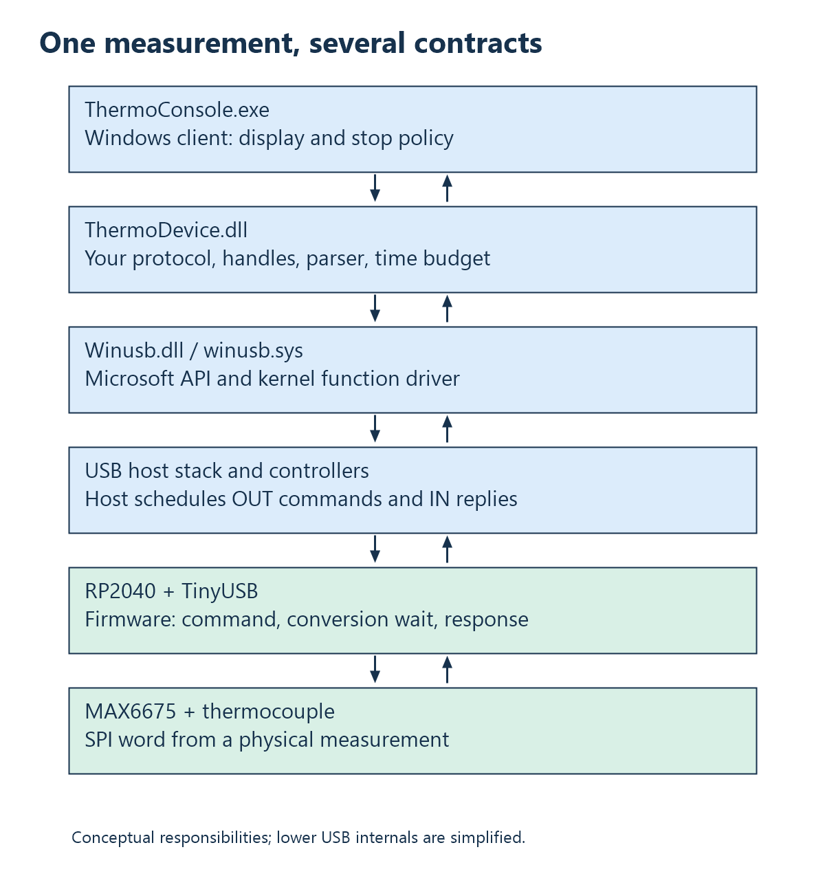

# 1. The complete measurement

## A number on the screen is the end of a chain

Imagine that the console prints `25.25 C`. It is tempting to describe this as
“reading the USB device.” That phrase hides several independent operations.
The thermocouple produces an electrical signal. The MAX6675 converts it into a
digital result. The RP2040 reads that result using SPI. Firmware creates a byte
array. USB carries those bytes into Windows. A DLL validates and decodes them.
Finally, the console formats a floating-point value as text.

Each boundary has a different contract. SPI has a clock and chip select. USB
has endpoints, descriptors, and host-controlled transfers. The DLL has function
arguments and status values. The console has command-line options and output.
A successful measurement means that these contracts agree, not merely that a
cable is connected.



The arrows in this diagram describe responsibility and data flow. They do not
show every physical USB transaction or every Windows internal driver object.

## Two computers, two executables

The RP2040 and the PC execute different machine code. The RP2040 runs an Arm
firmware image built by the Pico toolchain. The PC runs an x64 Windows program
and DLL built by Visual Studio. Copying `ThermoConsole.exe` to the RP2040 would
not make sense: its instruction set, executable format, runtime, and operating
system assumptions differ.

Conversely, a `.uf2` is a flashing container for firmware, not a Windows
application. Boot mode temporarily exposes a programming interface. After the
image starts, the application firmware defines the board's runtime USB
personality. The BOOT-mode mass-storage interface is not the thermometer's
vendor interface.

The CMake project deliberately builds three alternatives. `firmware` is the
serial-terminal sensor experiment, `usb_probe` is the synthetic USB experiment,
and `thermometer_usb` is the current integrated thermometer. Flashing one
replaces the running application; the three images are not cooperating tasks.

## Follow one request

Read [ThermoConsole.cpp](../../ThermoHost/ThermoConsole/ThermoConsole.cpp).
Its central operation is this existing call:

```cpp
Status = pRead(pDevice, &TemperatureC);
```

`pRead` is a function pointer resolved from the loaded DLL. `pDevice` identifies
private state in that DLL. `&TemperatureC` gives the function somewhere to store
the result. No temperature is returned as the function's integer return value:
that value is an operation status.

Inside the DLL, the call becomes a command containing `THQ2` and a random token.
The board recognizes the command, restarts a conversion, waits, and reads the
sensor. Its response begins with `THR2` and repeats the token. The DLL returns a
temperature only after the response belongs to this particular request and its
flags are acceptable. This is a request/response system, not continuous
background acquisition.

Consider the ordering carefully. The physical probe may already have been at
25.25 degrees before the call. What becomes new is the requested conversion,
not necessarily the physical temperature. The result also describes a process
that takes time; it is not a zero-duration snapshot of the universe.

## Where each part lives

The [firmware directory](../../firmware/) contains device-side C and USB
descriptors. [ThermoDevice](../../ThermoHost/ThermoDevice/) contains the Windows
transport wrapper and decoder. [ThermoConsole](../../ThermoHost/ThermoConsole/)
contains the client. [protocol/thermo_wire.h](../../protocol/thermo_wire.h)
shares sizes and magic prefixes. [tests](../../tests/) exercises the parser
without a physical board.

The shared header is important but not a complete protocol specification. It
defines sizes and identifiers; the encoder, decoder, and
[protocol document](../protocol.md) establish field offsets and meanings.
A change to a constant alone does not automatically update all those meanings.

## Four kinds of “driver”

The word driver is used at different levels. The SPI API controls a hardware
peripheral on the microcontroller. TinyUSB contains a device-controller driver
and class implementation. Windows has USB host-controller, hub, and function
drivers. Your DLL is a device-specific user-mode library that calls WinUSB.
These components cooperate but are not interchangeable.

You have direct access to USB operations through WinUSB, but your application
does not write the PC's USB controller registers or construct electrical USB
signals. On the board, TinyUSB similarly handles much of the bus protocol.
Learning what those layers provide is how you decide when a lower-level driver
is actually necessary.

## Three failure locations

If the thermocouple is open, communication may still work perfectly: the board
returns a fault response. If the wrong firmware is installed, Windows may find
the device but the DLL rejects its capabilities. If the DLL cannot be loaded,
the console never reaches USB discovery at all. Treating all three as “USB
doesn't work” loses the most useful evidence.

Build a habit of naming the failing boundary. “LoadLibrary failed,” “no matching
interface,” “capability reply rejected,” and “sensor-fault response received”
describe different investigations. Later chapters turn this habit into a
diagnostic procedure.

## Check your understanding

1. Which processor executes `Thermo_ReadTemperature`? Which executes
   `max6675_read_raw`?
2. Why can an open thermocouple coexist with successful USB communication?
3. Why is API version 3 compatible with wire version 2 rather than requiring
   both numbers to be equal?
4. Draw the path from the console's output pointer to the MAX6675, marking each
   change of representation.

Answers: [Chapter 1 in the answer guide](24-answers.md#chapter-1).

<!-- NAVIGATION -->

---

[Contents](README.md) · [Next: 2. Bits, bytes, hexadecimal, and units](02-bits-bytes-and-numbers.md)
