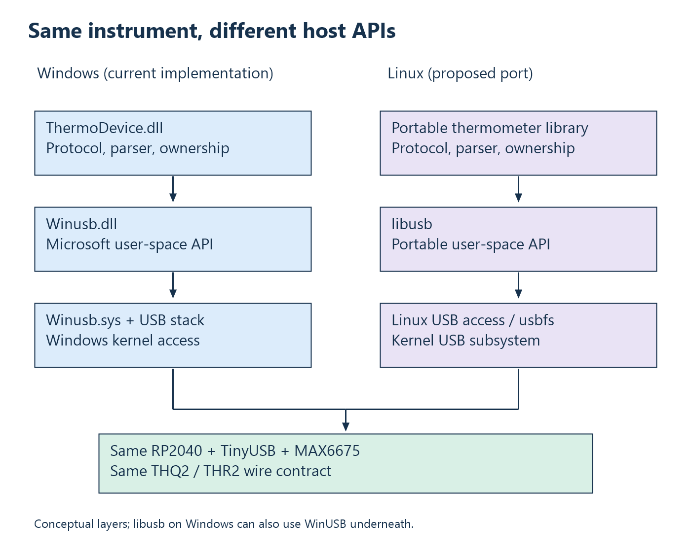

# 4. USB drivers in Windows and Linux

A USB controller is hardware. A driver integrates that hardware or a device
function with an operating system. A library exposes operations to application
code. Understanding these roles prevents a common mistake: calling every layer
between a program and a cable “the driver.”

Start with the operating-system problem. Several applications and devices may
coexist; hardware can disappear; transfers can outlive the function that
submitted them. The OS must manage access, requests, interrupts, memory,
power, and removal. A user program ordinarily asks the OS to perform I/O
rather than directly programming the host controller.

## Shared architecture, different implementations

On the host, controller and hub support provide general USB infrastructure.
A function or interface driver supplies the device-facing access model above
that infrastructure. Applications may use a class subsystem, a general USB
API, or a product-specific library. The exact component names differ by OS;
the responsibilities are recognizable on both.

For example, a keyboard integrates with input services and a disk with storage.
Applications normally want key events or files, rather than raw endpoint
traffic. An experimental laboratory instrument may instead expose private
commands that a general-purpose input or storage driver cannot interpret.

The first design question is therefore semantic: should this device behave as
a standard system function, or provide a private protocol to an application?
The answer precedes the choice of host API.

## Windows: WinUSB separates transport from product logic

### What crosses the user/kernel boundary?

An application owns a buffer in its virtual address space and asks an API to
read or write. OS I/O machinery turns that operation into managed work for the
device stack. Later, completion reports status and an actual byte count. The
application reasons about its buffer and request; it does not need the USB
controller's register addresses.

This separation is useful because requests coexist with other processes and
hardware events. If the cable is removed while a read is pending, the OS must
resolve the request and device state rather than let the application continue
assuming the hardware exists. Product software must then interpret the error
and release its own resources. General device management and product recovery
policy meet at that boundary.

User mode also has limits. A library can validate and interpret data without
becoming an operating-system driver. A framework driver running in user mode
is still a driver because it participates in the framework's device/request
lifecycle; a normal DLL loaded by a console does not gain that role simply
by making USB calls. Execution location and responsibility are separate axes.

With that distinction established, we can compare two practical user-space
access routes below. The firmware's command bytes can be identical through
either route even though the host objects and submission APIs differ.

### Microsoft's generic access route

Microsoft's WinUSB provides a generic route for private USB access. Its
user-mode component, `Winusb.dll`, exposes API functions. Its kernel-mode
component, `Winusb.sys`, can serve as the USB function driver. Your product
library can then encode commands, validate replies, and expose meaningful
operations without implementing that function driver itself. See Microsoft's
[WinUSB architecture](https://learn.microsoft.com/en-us/windows-hardware/drivers/usbcon/winusb-architecture).

The historical motivation is reusable transport. If many products need bulk
commands and replies, duplicating similar kernel forwarding code for each
product is unnecessary work. A generic driver lets a product team retain
device semantics in user mode while reusing system USB support.

WinUSB belongs to the Vista generation of native Windows support; older
32-bit XP SP2-era support used a coinstaller. Isochronous API support arrived
later, with Windows 8.1. This explains differences between old tutorials; it is
not an invitation to follow obsolete installation procedures. Microsoft's
[driver-model comparison](https://learn.microsoft.com/en-us/windows-hardware/drivers/usbcon/winusb-considerations)
documents the historical availability and model tradeoffs.

WinUSB knows endpoints and transfers. It does not know that a setpoint uses
millivolts or a flag means a disconnected thermocouple. That interpretation
belongs in firmware and product software.

## Linux: libusb above the USB subsystem

A common Linux user-space route uses **libusb**, a portable open-source C
library, above Linux USB access facilities. The kernel still owns USB bus
operations. libusb is not a replacement kernel, a device firmware stack, or a
Microsoft component. Its [project overview](https://libusb.info/) and
[platform notes](https://github.com/libusb/libusb/wiki) describe that role.

There is no exact Linux object corresponding to the combined name “WinUSB.”
Compare responsibilities instead:

| Responsibility | Windows private-interface route | Linux user-space route |
| --- | --- | --- |
| Instrument semantics | Product library/application | Product library/application. |
| User API | WinUSB functions | libusb functions. |
| Discovery | Device interfaces, commonly SetupAPI | libusb enumeration and selection. |
| Kernel access | WinUSB and Windows USB stack | Linux USB subsystem/user access facilities. |
| Device firmware | Independent of host API | Independent of host API. |

Linux kernel USB drivers use kernel APIs and request objects called URBs.
Linux device-side **gadget** drivers have another role: implementing USB
peripheral behavior on suitable Linux hardware. Neither is the same as a
desktop libusb program. The [Linux host-side API guide](https://www.kernel.org/doc/html/latest/driver-api/usb/usb.html)
distinguishes these layers.

libusb also runs on Windows and can use WinUSB as a backend. Choosing libusb
can make application transport code portable while still relying on OS-specific
drivers underneath. The [Windows backend documentation](https://github.com/libusb/libusb/wiki/Windows)
explains that arrangement. Portability concerns the chosen abstraction, not
the disappearance of all platform differences.

## Access, ownership, and permissions

An application must find the intended interface, obtain permission to access
it, and establish the relevant open/claim state. A library that compiles
successfully can still fail because the interface is busy or unavailable.
On Linux, device-node permissions and interface ownership are separate from
protocol compatibility. On Windows, discoverable paths and driver binding
likewise precede private-protocol checks.

A narrow device-access policy is preferable to treating permanent administrator
or root execution as part of the application design. Similarly, detaching a
standard class driver indiscriminately may remove needed system behavior.
Identify the specific interface and access model first. libusb's
[device-handling API](https://libusb.sourceforge.io/api-1.0/group__libusb__dev.html)
documents claiming interfaces and supported driver-handling operations.

## Example: a programmable power supply

Suppose a hypothetical device accepts “set channel 1 to 3300 millivolts.”
The application expresses the operation; its library validates and encodes it;
the OS carries bytes; firmware applies the change and replies. WinUSB or libusb
can provide the host transport without defining the electrical operation.

Now lose the reply after the device applies the change. A timeout does not
tell the host whether the action occurred. Retrying an absolute setpoint may
be idempotent; retrying “increase by 100 millivolts” may act twice. The protocol
must define retries and command identity. A general USB driver cannot infer
the safe policy from the payload bytes.

For a real reference device, Microsoft's [WinUSB walkthrough](https://learn.microsoft.com/en-us/windows-hardware/drivers/usbcon/using-winusb-api-to-communicate-with-a-usb-device)
uses the OSR USB FX2 learning kit. The same discovery/endpoint concepts apply
to different hardware; its private commands do not become universal USB
commands merely because it uses the same API.

## Example: the thermometer's host paths

The left column corresponds to ThermoHost's current implementation. The Linux
column is a possible port, not existing application code. The wire protocol
can remain unchanged while discovery, I/O calls, time sources, and resource
cleanup change.

The thermometer's `ThermoDevice.dll` is a product library. Microsoft's WinUSB
components provide OS USB access. TinyUSB on the board belongs to the other
side of the cable and has a different purpose, examined next.

## When a custom driver is justified

A device needing system-class integration, framework-managed request policy,
or other requirements beyond the selected user-space route may need a custom
driver. In Windows, study WDF; in Linux, study the kernel USB interface-driver
model. Both introduce lifecycle, concurrency, removal, and power obligations.
They do not automatically improve sensor conversion time or establish hard
real-time application behavior.

**Exercises.** Locate product semantics in the power-supply example. Explain
why libusb is not “Linux's winusb.sys.” See
[Appendix A](appendix-a-exercises.md#chapter-4).

<!-- NAVIGATION -->

---

[Previous: 3. Enumeration, descriptors, and identity](03-enumeration-and-descriptors.md) · [Contents](README.md) · [Next: 5. Embedded USB stacks and TinyUSB](05-tinyusb.md)
