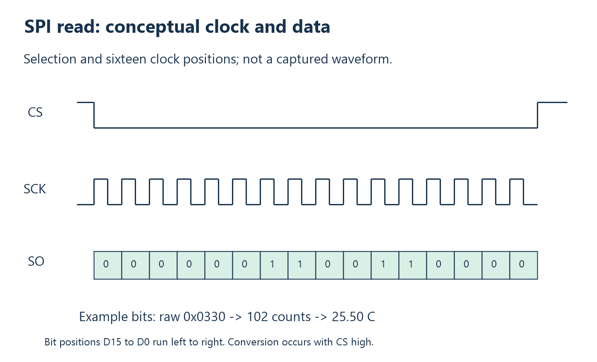

# 4. SPI: from pins to a sensor word

## SPI has an explicit clock

SPI is a synchronous serial connection: one participant generates a clock, and
the participants shift data relative to its edges. In this project the RP2040
is the controller and the MAX6675 supplies the result. Chip select delimits the
read. This local connection is independent of USB; it does not have USB
addresses, descriptors, or WinUSB handles.

The actual initialization in
[thermometer_usb.c](../../firmware/thermometer_usb.c) is:

```c
gpio_init(MAX6675_CS_PIN);
gpio_put(MAX6675_CS_PIN, 1);
gpio_set_dir(MAX6675_CS_PIN, GPIO_OUT);

spi_init(spi0, 1000000);
spi_set_format(spi0, 8, SPI_CPOL_0, SPI_CPHA_0, SPI_MSB_FIRST);
gpio_set_function(MAX6675_SO_PIN, GPIO_FUNC_SPI);
gpio_set_function(MAX6675_SCK_PIN, GPIO_FUNC_SPI);
```

The CS output latch is set high before the output direction is enabled. This
avoids deliberately driving a low selection pulse during configuration. The
sensor should be deselected while it converts. GP1 remains an ordinary GPIO;
the program controls it explicitly rather than assigning automatic hardware
chip selection.

The pin-function calls connect GP0 and GP2 to the SPI peripheral. A GPIO number
alone does not choose what hardware drives it. The board definition's default
SPI pins do not override these explicit project choices.

## Interpret the format arguments

`spi0` chooses the peripheral instance. `1000000` requests a clock of 1 MHz.
The hardware divider determines the obtainable rate; the original diagnostic
firmware prints the returned actual rate. `8` chooses eight-bit transfers at
the SDK interface, so two transfers read the sixteen-bit word. `SPI_MSB_FIRST`
requests most-significant-bit ordering.

CPOL 0 means the clock idles low. CPHA 0 selects the first sampling edge for
this format. Timing compatibility must be checked against the sensor rather
than assumed from a familiar “mode” number. The project contains functioning
code with those settings; for a new sensor, inspect setup and hold requirements
and then confirm the waveform. The official
[Pico SDK hardware API](https://www.raspberrypi.com/documentation/pico-sdk/hardware.html)
documents these parameters and `spi_read_blocking`.



The illustration labels sixteen clock positions. It is a conceptual timing
diagram, not an oscilloscope capture and not a replacement for the datasheet's
edge timing limits. USB is not synchronized to these individual clock edges.

## The read function, line by line

```c
uint8_t bytes[2];

gpio_put(MAX6675_CS_PIN, 0);
sleep_us(1);
spi_read_blocking(spi0, 0, bytes, sizeof(bytes));
sleep_us(1);
gpio_put(MAX6675_CS_PIN, 1);

return ((uint16_t)bytes[0] << 8) | bytes[1];
```

`bytes` is a two-byte local buffer. Bringing CS low selects the converter's
serial output. The short delay allows it to become ready before clocking.
`spi_read_blocking` clocks two bytes, transmitting dummy zeros while receiving.
“Blocking” means this call does not return until that SPI read finishes; it
does not mean the whole 250 ms conversion is performed inside it.

The second short delay precedes deselection. Bringing CS high permits the
next conversion. The return expression shifts the first received byte into
the high eight bits, then combines the second byte using OR. Casting to
`uint16_t` makes the intended word size clear before shifting.

At 1 MHz, sixteen clock cycles occupy approximately 16 microseconds, plus
selection delays and software overhead. Compare that with 250 milliseconds:
the conversion allowance is over ten thousand times longer. Optimizing away a
microsecond of GPIO overhead would barely affect user-visible read latency.

## The raw word is not the wire packet

The raw sensor word has temperature bits in positions 14 through 3 and an
open-thermocouple indicator at bit 2. The encoder extracts those fields; it does
not forward all sixteen raw bits to Windows. The Windows protocol adds its own
magic, flags, timestamp, and token. Consult the
[sensor datasheet](https://www.analog.com/media/en/technical-documentation/data-sheets/max6675.pdf)
for the complete word and timing definition.

For raw `0x0550`, shifting and masking gives 170 counts. Multiplying by 0.25
gives 42.5 degrees; multiplying by 25 gives wire value 4250, or `0x0000109A`.
The output field becomes `9A 10 00 00`. This one worked example contains two
byte orders, two scales, and three representations: SPI bytes, raw integer,
and protocol field.

## Restarting a conversion deliberately

The fresh-read firmware briefly pulses CS low then high after recognizing a
request. It then sets a deadline 250 ms into the future. This establishes the
causal order “command received, conversion restarted, wait completed, sensor
read.” Without the restart, a read might simply retrieve a conversion that
began before the host asked.

The code does not sleep for the whole conversion in this path. It services USB
and checks time in successive loop iterations. That distinction will become
central in chapter 10. A tiny blocking SPI transaction is compatible with this
design; a long blocking conversion delay would interfere with responsiveness.

## Observe before optimizing

A logic analyzer connected to CS, SCK, and SO can show whether the sensor was
selected, whether sixteen clocks occurred, and what bits were returned. A USB
software trace cannot directly show those pins. Likewise a logic analyzer on
SPI cannot tell whether Windows discarded a stale token. Choose the instrument
that observes the failing boundary.

Start captures before requesting a conversion. Look for the restart pulse,
approximately 250 ms with CS high, and the read pulse with clocks. If your
instrument decodes SPI, configure bit order and phase to match, then verify
at least one word manually so an incorrect decoder setting does not mislead
you.

## Check your understanding

1. Why does GP1 use GPIO calls while GP0 and GP2 use `GPIO_FUNC_SPI`?
2. What does the second argument `0` in `spi_read_blocking` mean here?
3. Decode SPI bytes `05 50` into the four temperature bytes sent to Windows.
4. Why does the command restart the conversion before waiting?

Answers: [Chapter 4](24-answers.md#chapter-4).

<!-- NAVIGATION -->

---

[Previous: 3. Hardware and the meaning of a measurement](03-hardware-and-measurement.md) · [Contents](README.md) · [Next: 5. USB without the mystery](05-usb-mental-model.md)
