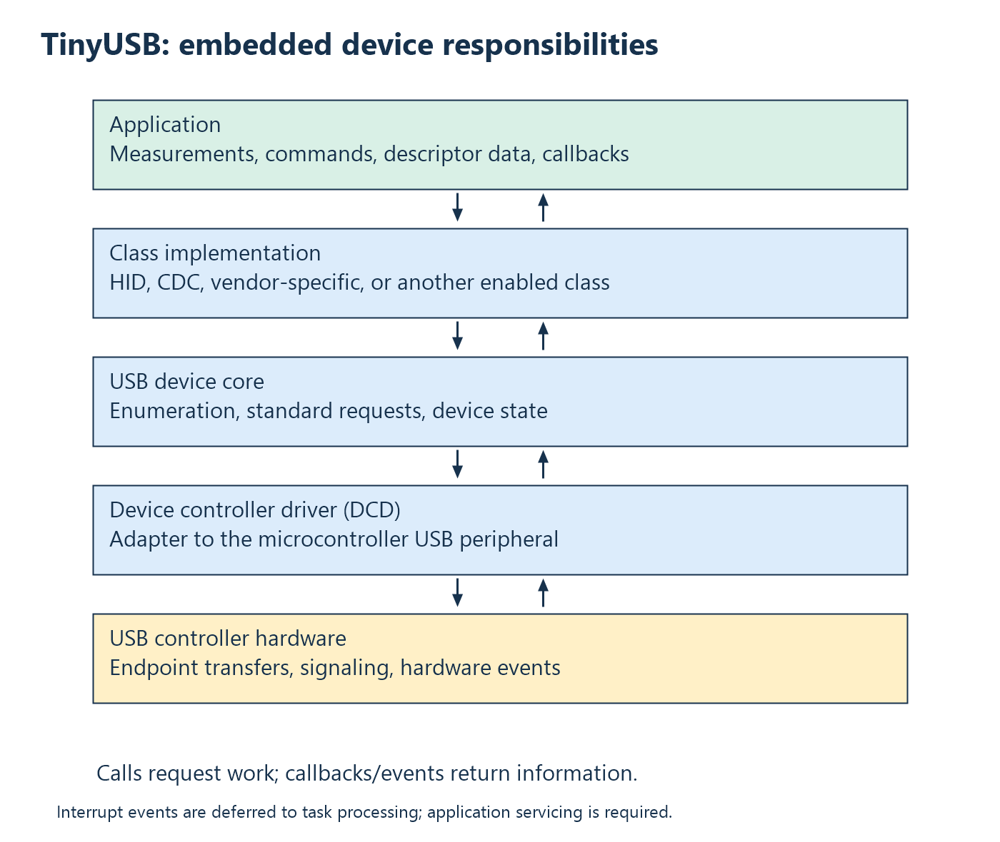

# 5. Embedded USB stacks and TinyUSB

The previous chapter examined USB from an operating system's host side. A
microcontroller needs corresponding device-side software: something must
configure its controller, answer enumeration requests, manage endpoints, and
notify the application when work occurs. An **embedded USB stack** supplies
those reusable services.

TinyUSB is an open-source stack for embedded systems, credited to Ha Thach
and contributors. It supports host and device roles on supported hardware.
This book uses its device stack; it does not run libusb or Windows drivers on
the microcontroller. Its [repository](https://github.com/hathach/tinyusb)
and [license](https://github.com/hathach/tinyusb/blob/master/LICENSE) identify
the project and authorship. Raspberry Pi integrates it into the Pico SDK;
integration does not change its upstream origin.

## Why use a stack?

Consider a board that should act as a keyboard. Application code knows which
keys are pressed. It should not also need to implement every USB enumeration
request or every controller-specific endpoint operation. Separating those
responsibilities allows the same keyboard behavior to work on different
microcontrollers and lets USB mechanisms be tested independently.

An instrument has the same need. Its application understands measurement and
command policy; a stack handles general device USB machinery. Using a stack
does not eliminate low-level learning. It establishes a boundary from which
you can investigate controller behavior without reimplementing the entire
protocol at once.

## The layers inside TinyUSB



At the bottom, a **device controller driver** (DCD) adapts the stack to a
specific MCU USB peripheral. Above it, the device core manages general USB
device behavior. Class drivers implement interfaces such as CDC, HID, or a
vendor interface. Application code supplies descriptors and device-specific
behavior. The [TinyUSB architecture guide](https://docs.tinyusb.org/en/latest/reference/architecture.html)
describes this layering.

“Driver” therefore appears on both ends of the cable. A Windows function
driver integrates a device with Windows. A TinyUSB controller driver operates
an embedded peripheral. A TinyUSB class implementation supplies device-side
class behavior. They cooperate through USB, but are different programs with
different APIs and execution environments.

The hardware handles electrical signaling and controller operations; the stack
handles USB state/protocol work; the application handles product semantics.
For example, only the application knows whether a requested conversion has
finished. A generic vendor interface cannot invent a valid measurement.

## Calls and callbacks

A normal function call asks a library to do work. A **callback** is supplied
by the application so a library can ask for information or report an event.
Descriptor callbacks reverse the familiar direction: the stack asks your code
which device/configuration/string bytes it should return.

Callbacks must obey lifetime rules. Returning a pointer to a local descriptor
array is invalid once that function returns. Static or otherwise sufficiently
long-lived storage is needed. A callback's execution context also matters:
do not assume every callback is safe for arbitrary blocking or concurrent work.

This structure resembles an operating-system event model, but does not require
a full operating system. The application can run a cooperative main loop or
integrate the stack with an RTOS. The [integration guide](https://docs.tinyusb.org/en/latest/integration.html)
describes initialization, descriptors, interrupts, and regular task servicing.

## Interrupts and deferred processing

A hardware interrupt indicates that something requires service. Doing all
application work inside an interrupt handler would increase latency for other
interrupts and complicate synchronization. TinyUSB defers substantial event
processing into its task path. The application must allow that path to run.

Think of a receptionist and a work queue. Recording that a package arrived
is short work; opening it, checking its meaning, and contacting a customer are
later work. The analogy is limited, but useful: an interrupt notice and a
completed application operation are not the same event.

In a cooperative program, a long computation or delay between task calls can
postpone USB work. A stack does not become an independent background thread
merely because it was initialized. Version-specific interrupt/task details
should be checked against the installed stack, not guessed from a generic
example.

## Configuration must agree with descriptors

Three pieces must match: enabled class implementations, descriptors describing
those classes, and the application behavior they require. Enabling HID in a
configuration header without supplying matching descriptors and reports is
not a complete HID device. Conversely, advertising an interface whose class
implementation is absent is an inconsistent build.

The [TinyUSB class integration guide](https://docs.tinyusb.org/en/latest/reference/class/device.html)
explains these connections. Class-count macros describe available instances;
buffer sizes configure finite storage. Neither supplies an application protocol
automatically.

For a vendor class, the application defines the payload. For CDC, applications
obtain serial-style data handling but still need a message format if commands
and binary results are exchanged. “USB serial” is not itself a thermometer
protocol.

## Worked example: the thermometer's configuration

The [local TinyUSB configuration](../../firmware/usb/tusb_config.h) contains:

```c
#define CFG_TUD_VENDOR 1
#define CFG_TUD_CDC 0
#define CFG_TUD_MSC 0
#define CFG_TUD_HID 0
#define CFG_TUD_MIDI 0
```

There is one vendor instance and no CDC console in this target. Separate
settings choose full speed, endpoint-zero size 64, bulk endpoint size 64, and
64-byte vendor receive/transmit FIFOs. Packet size and FIFO capacity happen
to be equal here, but remain different concepts.

The live firmware initializes device role and repeatedly calls
`tud_task_ext(0, false)`. In the installed stack accompanying Pico SDK 2.3.1,
this drains pending work without waiting for a new event. The local
implementation has a void return type; newer online API descriptions can
differ. The code's clock hook supplies milliseconds from the Pico uptime
clock.

## Receive, queue, and flush

`tud_vendor_available()` reports available receive data;
`tud_vendor_read()` copies bytes into application storage. The program can
assemble a command across several iterations rather than assume it arrived
as one complete API result.

`tud_vendor_write()` accepts as many offered bytes as the transmit path can
take and returns a count. If fewer than requested are accepted, the application
must retain the remaining bytes. `tud_vendor_write_flush()` asks the stack to
submit queued data. Neither call proves the host application decoded it.

This is **backpressure**: downstream capacity constrains immediate progress.
A correct application remembers progress instead of discarding or duplicating
bytes. USB interface readiness also differs from a host application holding
an open session. A configured interface can exist while no client is reading.

## Combining device classes deliberately

A CDC debug console and a vendor data interface can coexist in a deliberately
designed composite device. They do not appear automatically because two
libraries both enable USB. Descriptors, interface numbering, endpoints, stack
configuration, and host access must agree.

ThermoHost avoids that extra complexity in its vendor targets by disabling SDK
USB stdio. Its older terminal target enables CDC instead. The decision changes
the runtime USB personality, not the physical sensor wiring.

**Exercises.** Explain why a stack needs task servicing after initialization.
Distinguish queue acceptance, bus transfer, and host decoding. See
[Appendix A](appendix-a-exercises.md#chapter-5).

<!-- NAVIGATION -->

---

[Previous: 4. USB drivers in Windows and Linux](04-operating-system-drivers.md) · [Contents](README.md) · [Next: 6. Peripherals, sampling, and SPI](06-peripherals-and-acquisition.md)
