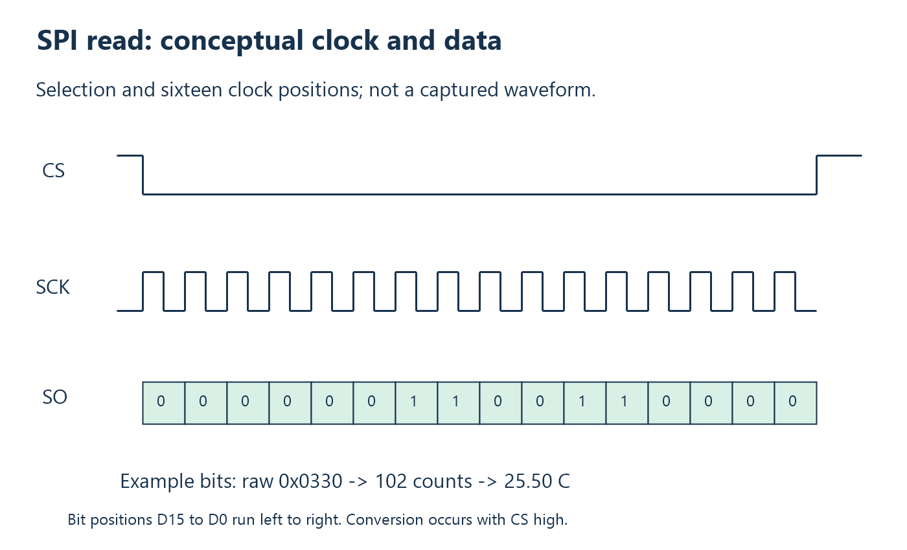

# 6. Peripherals, sampling, and SPI

Communication transports a representation of a measurement. It cannot improve
the measurement merely by moving its bytes faster. A sensing element responds
to a physical quantity; a converter produces a digital result; a processor
reads that result; a transport delivers it. These stages have different
timing and error properties.

This separation is useful even outside instrumentation. A camera sensor,
button, and temperature converter all have behavior before USB sees any
payload. Start with that behavior when deciding sample rate, timestamp, and
validity rules.

## Resolution, accuracy, and response time

Resolution is the smallest representable step. Accuracy is closeness to the
physical value. Repeatability concerns agreement under repeated conditions.
Response time describes how quickly the system follows change. None is
established by the number of decimal places in a display.

A 0.25-degree converter can be encoded in hundredths for convenience, but that
does not produce 0.01-degree measurements. A fast serial read can retrieve a
result quickly, but cannot shorten the underlying conversion interval or the
probe's physical response.

Validity is also specific. A disconnected-sensor flag reports a detected
condition. Its absence does not prove calibration, correct placement, or an
undamaged probe. Good transport and good measurement are separate claims.

### Quantization and physical error

For an ideal uniform quantizer that rounds to 0.25-degree steps, half a step
is 0.125 degrees. A physical value near a boundary can therefore move between
adjacent codes even when the underlying change is small. This is a model of
representation error, not a statement that a real converter's total error is
bounded by 0.125 degrees.

Calibration error, reference-junction error, noise, and probe placement can
be larger. Averaging repeated readings can reduce some varying noise under
appropriate assumptions, but cannot automatically remove a constant offset.
The distinction tells you which experiment to perform: repeated stationary
readings investigate variation; comparison with a known reference investigates
accuracy.

## SPI's responsibilities

SPI is a synchronous serial connection. A controller generates a clock, and
participants shift data relative to its edges. Chip select usually delimits a
transaction. Unlike USB, this local connection has no host enumeration or USB
interface descriptors.

Clock polarity determines idle level; phase determines sampling relative to
clock edges. Bit order determines which bit shifts first. Device timing limits
specify acceptable clock rates and setup/hold intervals. Matching these rules
is more important than memorizing a mode number.

A hardware SPI peripheral performs the shifting. Application code configures
it and reads/writes buffers rather than manually toggling each bit. Pin-function
selection connects GPIO pins to that peripheral; defining a pin number alone
does not configure its electrical function.

## Example: a read-only temperature converter

The MAX6675 performs thermocouple conversion and reference-junction compensation,
provides a twelve-bit result at 0.25 C/count, and reports an open thermocouple.
The project's 250 ms allowance exceeds the datasheet's 220 ms maximum conversion
time under its stated conditions. See the
[MAX6675 datasheet](https://www.analog.com/media/en/technical-documentation/data-sheets/max6675.pdf).

The [live firmware](../../firmware/thermometer_usb.c) uses SPI0 at 1 MHz, with
SO on GP0, CS on GP1, and SCK on GP2. There is no sensor MOSI command input in
this read-only connection. Dummy transmitted bits generate clocks while the
controller receives.

```c
gpio_init(MAX6675_CS_PIN);
gpio_put(MAX6675_CS_PIN, 1);
gpio_set_dir(MAX6675_CS_PIN, GPIO_OUT);

spi_init(spi0, 1000000);
spi_set_format(spi0, 8, SPI_CPOL_0, SPI_CPHA_0, SPI_MSB_FIRST);
gpio_set_function(MAX6675_SO_PIN, GPIO_FUNC_SPI);
gpio_set_function(MAX6675_SCK_PIN, GPIO_FUNC_SPI);
```

Setting the output latch high before enabling output avoids deliberately
selecting the converter during setup. CS remains an ordinary GPIO because
application logic controls conversion restart and read selection. Data and
clock pins use the SPI function. The [Pico hardware API](https://www.raspberrypi.com/documentation/pico-sdk/hardware.html)
documents these operations.

## Readout is shorter than conversion



The actual read selects the sensor, waits briefly, clocks two bytes, and
deselects it:

```c
gpio_put(MAX6675_CS_PIN, 0);
sleep_us(1);
spi_read_blocking(spi0, 0, bytes, sizeof(bytes));
sleep_us(1);
gpio_put(MAX6675_CS_PIN, 1);

return ((uint16_t)bytes[0] << 8) | bytes[1];
```

The SPI call blocks for the short readout. Sixteen 1 MHz clocks take about
16 microseconds, plus selection and software overhead. The 250 ms conversion
allowance is much longer. Thus a faster serial clock barely changes the
measurement cycle in this example.

The sensor sends its high byte first, so reconstruction shifts the first byte
left eight bits. The later USB application encoding is little endian. Byte
order at one boundary does not dictate byte order at another.

## Define the measurement time

A conversion occupies time. Reasonable timestamp definitions include conversion
start, estimated midpoint, completion, readout, and host receipt. Choose one,
state the clock it uses, and distinguish timestamp precision from knowledge
of physical sampling time.

ThermoHost records device uptime after sensor readout. This is neither Windows
wall time nor the display time. Its DLL does not expose that timestamp through
the public temperature API. A synchronized acquisition application would need
a more explicit time model and appropriate result fields.

The firmware restarts a conversion after a command and waits before reading.
That establishes causal freshness for the requested measurement. It does not
make the value instantaneous, or prove an upper bound on its age when displayed.

### Two clocks in one measurement

Imagine device uptime says conversion restarted at 1000 ms and readout
occurred at 1250 ms. Those observations establish a 250 ms device-side interval.
Separately, the host records a call beginning at its uptime 900000 ms and
ending at 900280 ms: host-observed duration is 280 ms.

Subtracting device timestamp 1250 from host timestamp 900280 does not give
transport delay. Their zero points differ, and their rates may differ slightly.
You can compare intervals within each clock without synchronization; comparing
absolute events between clocks needs a relationship between them. This is why
adding a timestamp field is only the beginning of a timing design.

## Observe the correct boundary

A logic analyzer can reveal CS, clocks, and SO bits. A USB capture can reveal
payload transfers. A console timestamp measures host-observed call duration.
Each instrument answers a different question; none substitutes for all the
others.

For the conceptual waveform, verify clock phase and bit ordering against the
device requirements before trusting a decoder. The figure is an illustration,
not a board capture or a datasheet timing diagram.

**Exercises.** Why does 1 MHz SPI not imply one million temperature samples
per second? Decode raw `0x0550` through counts, degrees, and fixed-point bytes.
See [Appendix A](appendix-a-exercises.md#chapter-6).

<!-- NAVIGATION -->

---

[Previous: 5. Embedded USB stacks and TinyUSB](05-tinyusb.md) · [Contents](README.md) · [Next: 7. Application protocols and message framing](07-protocols-and-framing.md)
