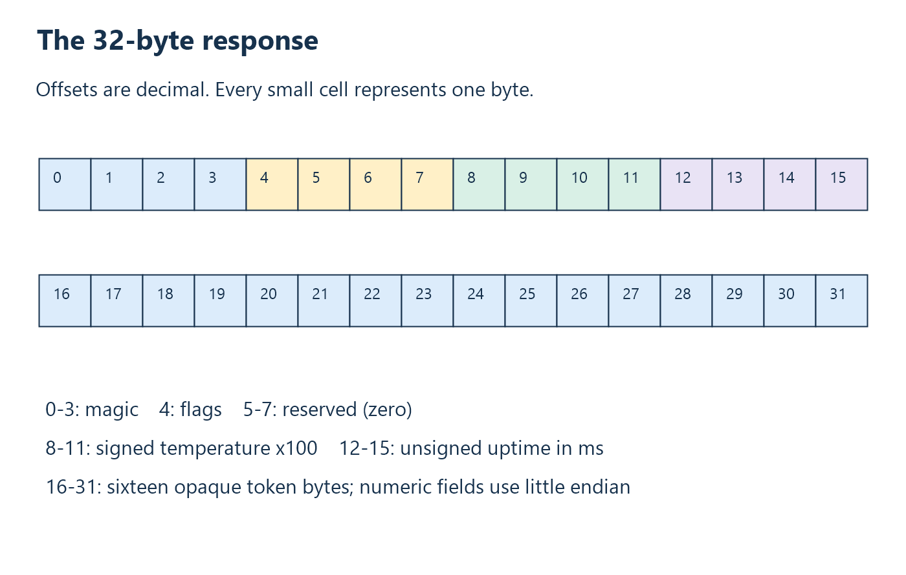

# 7. Application protocols and message framing

A transport delivers bytes under defined rules. An **application protocol**
defines what those bytes mean: operations, lengths, units, versions, identifiers,
and error responses. Reliable transport cannot decide whether a number is a
temperature, whether a reply belongs to the current command, or whether a
completed command may safely be repeated.

This chapter develops the contract above USB. The same principles apply to
serial links, network sockets, files, and interprocess messages.

## Define messages independently of native objects

A specification should identify fields by byte offset, width, representation,
and meaning. Avoid transmitting a native C structure unless its layout is
explicitly constrained and portable across every participant. Compiler padding,
alignment, byte order, and pointer sizes are otherwise hidden dependencies.

For each numeric field, state signedness and units. For each flag, state which
bits are valid. For each reserved field, state what senders write and receivers
accept. This prevents “unused” storage from becoming an accidental extension
mechanism.

Zero-initializing an outgoing frame before filling its fields establishes
reserved values and avoids transmitting uninitialized memory. This is part of
encoding correctness, not a substitute for specifying the fields.

## Finding boundaries

Common framing methods include fixed length, a length prefix, delimiters with
escaping, and self-describing encodings. A fixed-length message is simple but
less flexible. A length prefix supports variable payloads but must be bounded
and validated. A delimiter can aid recovery but must be distinguished from
the same byte inside payload data.

A magic prefix can help find a candidate start. It does not by itself establish
validity: the same sequence might occur in data or noise. Version, length,
reserved fields, identifiers, and checksums can supply additional validation
where required.

Framing must survive fragmentation. Given the same byte sequence, a correct
parser should produce the same messages whether a transport returns one byte,
ten bytes, or several messages per read. USB packet boundaries do not eliminate
this obligation at the application/library boundary.

### Walk across a read boundary

Suppose one response contains thirty-two bytes, but the transport returns
chunks of 3, 10, and 19 bytes. The first chunk does not even contain the full
four-byte magic. After the second, thirteen response bytes exist, which is
still insufficient for the token at offsets 16–31. Only the third chunk
completes the candidate. A parser must remember its earlier bytes throughout.

Now prepend one unrelated byte. Counting thirty-two received bytes is no
longer enough: the first candidate begins at the wrong position. A parser
using a rolling window can reject that candidate, retain its suffix, and
recognize the response after the next byte. This explains why framing requires
both a completion rule and a recovery rule.

With variable-length messages, a similar process first assembles the header,
validates its declared size against a maximum, then collects the body. A
received length is input to validate before using it for allocation or buffer
access. The fixed-size thermometer avoids that particular length-field problem,
but still needs start recognition and identity checks.

## Correlation, ordering, and freshness

A request identifier connects a reply to a command. A sequence number orders
streamed samples or blocks. A timestamp locates data relative to a clock. These
fields answer different questions and should not be treated as substitutes.

Consider a command whose reply arrives after the host has timed out and begun
another command. Without correlation, the old reply can be mistaken for the
new one. Matching identifiers allow the host to skip it. But correlation alone
does not prove the underlying measurement was taken recently: firmware could
attach a new identifier to cached data.

Fresh acquisition therefore requires both a device-side acquisition policy
and a host-side matching policy. A timestamp and an age acceptance rule may
be necessary when “fresh” specifically means younger than a maximum age at
the point of use.

## Errors and retries are semantic decisions

Distinguish transport failure, malformed message, unsupported operation, and
valid reply reporting a device fault. A sensor-fault reply can be a successful
communication exchange. Garbage with no valid frame may instead end in a
timeout without a meaningful application error reply.

After a timeout, the host may not know whether an action occurred. Retrying
an idempotent absolute-setting command differs from retrying an increment.
Define this behavior when designing the protocol rather than assuming that
reliable USB delivery solves exactly-once execution.

Version negotiation should happen before interpreting incompatible payloads.
An API version describes the library contract; a wire version describes
message representation/semantics. Their numbers need not be equal.

### Specify error precedence

A frame can contain more than one suspicious field. Suppose its flags are
`0x03`: both the defined sensor-fault bit and an undefined bit are set. If a
receiver checks only the sensor bit, it could hide a protocol violation as
an ordinary device fault. Checking reserved bits first makes interpretation
consistent: this is a malformed current reply, not merely an open probe.

That rule should be documented alongside the byte layout. Senders, receivers,
and tests then agree about a result even when several conditions coexist.
Validation order is observable behavior, not just an implementation detail.

## Worked example: a request-driven thermometer

ThermoHost uses a fixed 20-byte request: four bytes `THQ2` followed by a
sixteen-byte random token. Its response has the following layout:



| Offset | Length | Meaning |
| --- | --- | --- |
| 0 | 4 | ASCII `THR2`. |
| 4 | 1 | Bit 0: open thermocouple; other bits zero. |
| 5 | 3 | Reserved zero bytes. |
| 8 | 4 | Signed temperature x100, little endian. |
| 12 | 4 | Unsigned device uptime at readout, milliseconds. |
| 16 | 16 | Exact request token echoed. |

The [shared constants](../../protocol/thermo_wire.h) define sizes and prefixes;
the [wire specification](../protocol.md) defines their complete meaning.
The encoder's initial operations are:

```c
memset(packet, 0, TEMPERATURE_PACKET_SIZE);
memcpy(packet, THERMO_RESPONSE_MAGIC, 4);
packet[4] = valid ? 0x00 : 0x01;
memcpy(packet + 16, token, THERMO_TOKEN_SIZE);
```

The magic's C terminator is excluded. The random token is opaque bytes, not a
string; it may contain zero and must be compared over all sixteen bytes.
It supplies correlation, not authentication.

## Work the bytes by hand

Use 25.50 C, uptime 1000 ms, and an illustrative token `00` through `0F`.
Temperature x100 is 2550 (`0x09F6`); uptime is `0x03E8`. The complete response is:

```text
54 48 52 32 00 00 00 00 F6 09 00 00 E8 03 00 00
00 01 02 03 04 05 06 07 08 09 0A 0B 0C 0D 0E 0F
```

There are thirty-two bytes; the displayed line break is not transmitted.
For an open thermocouple, byte 4 becomes `01` and temperature bytes are zero.
The receiver must report a fault rather than 0 C. A synthetic -10.25 C test
uses `FF FB FF FF` in the temperature field; that tests signed decoding,
not negative-range capability of this sensor.

At open, the host requires capability bytes `54 48 02 14 20`. They advertise
wire version 2 and lengths 20/32. The DLL's API version is 3. A ten-byte
streaming firmware is rejected before its bytes can be misread as this format.

## Publication after validation

A useful library rule is to preserve caller output on failure. Assemble and
check the response privately; only a matching valid reply writes a result.
That prevents an incomplete field, stale token, or sensor fault from becoming
a plausible new value.

This protocol checks framing, token, and reserved/flag fields. It does not
provide authentication, timestamp synchronization, or general measurement-health
validation. A larger application should add only the fields and checks its
requirements justify.

**Exercises.** Encode 42.25 C at uptime 2000 ms. Explain why an echoed token
alone cannot prove a newly acquired measurement. See
[Appendix A](appendix-a-exercises.md#chapter-7).

<!-- NAVIGATION -->

---

[Previous: 6. Peripherals, sampling, and SPI](06-peripherals-and-acquisition.md) · [Contents](README.md) · [Next: 8. Host libraries, APIs, and resource ownership](08-host-libraries-and-ownership.md)
