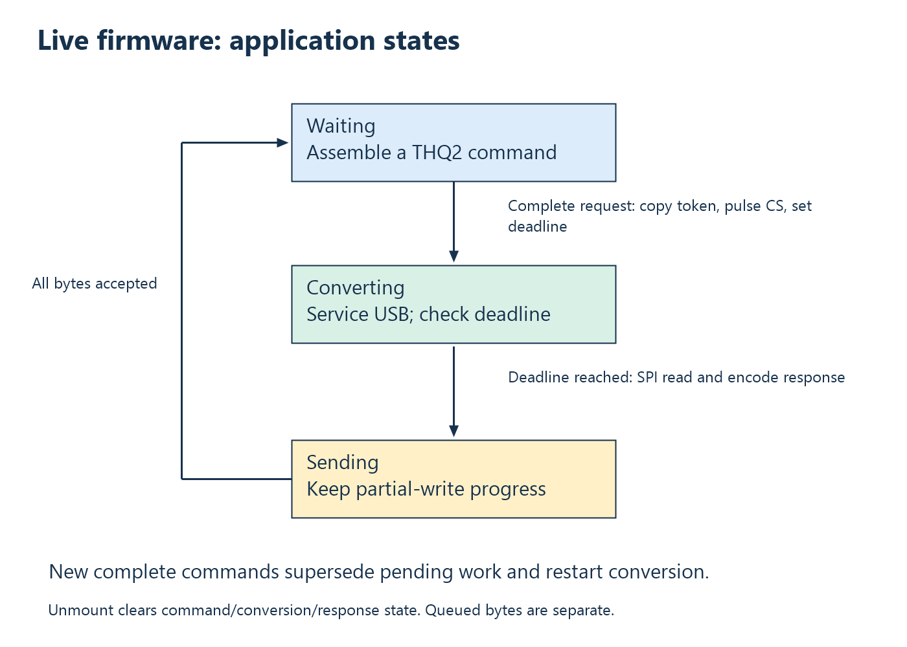

# 9. State machines, partial I/O, and cancellation

I/O often completes incrementally. A function may accept only part of a buffer;
a reply may arrive after several reads; a device may disappear while work is
pending. State machines make those intermediate conditions explicit.

A state machine consists of persistent state, events, and transitions. It is
useful whenever an operation cannot be understood as one indivisible function
call. The same method applies to embedded main loops, host parsers, and
asynchronous request lifetimes.

## Synchronous and asynchronous interfaces

A synchronous transfer waits in the calling thread until completion or failure.
An asynchronous interface separates submission from completion. The caller
can overlap operations, but must retain buffers and interpret later results.
libusb's [I/O introduction](https://libusb.sourceforge.io/api-1.0/libusb_io.html)
explains this distinction independently of a particular instrument.

An overlapped-capable Windows handle is a prerequisite for WinUSB initialization.
Passing a null per-operation `OVERLAPPED` pointer still uses the current calls
synchronously. Handle capability and actual application concurrency are
different facts.

Asynchrony does not create a sampling clock or hard deadline. It changes how
waiting and ownership are organized. A GUI can remain responsive while a
worker or completion path handles I/O, but the transport's scheduling properties
remain relevant.

## Partial progress is normal state

Suppose a sender offers 32 bytes and a software FIFO accepts ten. The next
offer must start at offset ten with length twenty-two. Sending all 32 again
duplicates data; forgetting the remainder loses it. The state is the buffer
plus the accepted-byte count.

On reception, the equivalent state is accumulated bytes plus framing position.
Transport chunk boundaries must not reset a parser arbitrarily. A timeout
can leave partial data in the parser and other transport buffers; protocol
correlation is needed to reason about that history.

## Example: cooperative conversion

A measurement command need not block a main loop for its entire conversion
interval. Record a future deadline, continue servicing USB, and check whether
the deadline has been reached on later iterations. Use “reached,” not exact
timestamp equality, because an iteration may occur slightly late.



In [thermometer_usb.c](../../firmware/thermometer_usb.c), `request_bytes`
tracks command assembly, `converting` guards a deadline, `response_ready`
tracks an encoded result, and `sent` tracks transmit progress. After conversion:

```c
if (converting && time_reached(conversion_done)) {
    uint16_t raw = max6675_read_raw();
    encode_temperature_packet(packet, raw,
        to_ms_since_boot(get_absolute_time()), token);
    converting = false;
    response_ready = true;
    sent = 0;
}
```

The next state queues response bytes while retaining progress:

```c
sent += tud_vendor_write(packet + sent, sizeof(packet) - sent);
tud_vendor_write_flush();
if (sent == sizeof(packet)) {
    response_ready = false;
}
```

A later complete command supersedes pending acquisition work and restarts
conversion. This is a policy, not a multi-request queue. Already queued
transport bytes may still exist. Unmount clears application command/conversion/
response state; it does not preserve a session across unplugging.

## Example: a rolling parser

The [response parser](../../ThermoHost/ThermoDevice/FreshResponse.h) collects a
32-byte candidate. Until it is full, it returns “not complete.” If prefix or
current token does not match, it shifts by one byte and retains the suffix:

```cpp
std::memmove(Bytes, Bytes + 1, --Count);
return false;
```

Keeping thirty-one bytes permits recovery when a valid frame starts inside a
rejected candidate. `memmove` is required for overlapping storage. A complete
matching candidate resets the count, checks reserved fields and flags, then
publishes a value only on the valid path.

An important invariant is `0 <= Count < 32` at the start of each normal feed
call. Incomplete candidates preserve a smaller count; rejected full candidates
reduce it to 31; matched candidates reset it to zero. That reasoning explains
buffer safety more generally than one successful test.

The parser persists across read calls. A late response with the old token
cannot normally satisfy a new random-token request. Noise and old tokens are
skipped; a matching malformed response returns InvalidPacket. Thus arbitrary
garbage may produce a timeout rather than that particular status.

## Time budgets across repeated operations

A per-call timeout renewed for each byte can accidentally allow a very long
total wait. A better request budget records start time, subtracts elapsed
time, and gives each subsequent wait only the remainder.

ThermoHost intends a 1000 ms command/response budget after token construction.
Its open/capability operation is separate. The budget includes skipping stale
data rather than restarting for each candidate. Pipe timeout behavior is
documented by Microsoft's [policy reference](https://learn.microsoft.com/en-us/windows-hardware/drivers/usbcon/winusb-functions-for-pipe-policy-modification).

A software budget is still not a hard wall-clock return guarantee. OS
descheduling, queueing, and completion processing affect observed duration.
State the intended waiting policy separately from a proven worst-case bound.

## Cancellation is a transition, not immediate destruction

For asynchronous work, distinguish FREE, SUBMITTED, COMPLETED, PROCESSING,
and RETIRED buffers. A cancellation request does not necessarily mean the
completion path has stopped using memory. Retain buffers and callback code
until the API's completion rules establish that outstanding work is drained.
The [libusb asynchronous reference](https://libusb.sourceforge.io/api-1.0/group__libusb__asyncio.html)
documents that transfer lifetime model.

The thermometer console uses a simpler synchronous policy. Its Ctrl+C handler
sets an atomic flag; main performs cleanup after any active read finishes.
Closing the object directly from the handler could race the read. The atomic
flag communicates stop intent; it does not make the device object generally
thread-safe.

**Exercises.** A 32-byte send accepts ten bytes, then zero, then twenty-two.
Describe its state after each call. Explain why cancellation requested is not
permission to free a submitted buffer. See
[Appendix A](appendix-a-exercises.md#chapter-9).

<!-- NAVIGATION -->

---

[Previous: 8. Host libraries, APIs, and resource ownership](08-host-libraries-and-ownership.md) · [Contents](README.md) · [Next: 10. Capacity, latency, and bottleneck calculations](10-capacity-and-bottlenecks.md)
