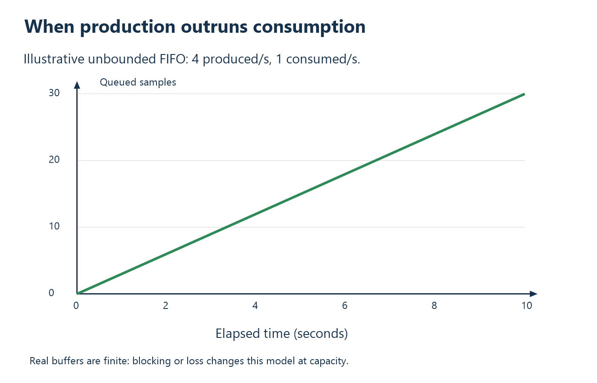

# 10. Capacity, latency, and bottleneck calculations

A capacity model compares required work with available service. Begin with units,
then account for representation and framing, identify the limiting resource,
and calculate buffering for temporary gaps. The model should label every
number as a specification limit, an assumption, or a measurement.

The acquisition examples below are hypothetical and can be repeated by hand.
The thermometer is used at the end to apply the same method to a different
kind of bottleneck. The [calculation checker](tools/check_calculations.py)
reproduces selected results with exact rational arithmetic.

## Begin with dimensions

Use a unit on every intermediate value. A frequency in samples/second cannot
be compared directly with bytes/second until you state bytes/sample. A bit rate
cannot be compared with a byte rate until you divide by eight. A packet size
cannot become throughput until you state packets/second.

In this chapter, kB and MB mean decimal 1000 and 1,000,000 bytes. KiB and MiB
mean binary 1024 and 1,048,576 bytes. Thus 64 KiB is 65,536 bytes; 64 kB is
64,000 bytes. At small scales the difference is visible in buffer calculations.

Define these quantities:

```text
C  = channel count
F  = scans per second (one scan contains one sample from every channel)
S  = stored bytes per channel sample
K  = scans per application block
H  = application header bytes per block

Raw sample rate     R_sample = C * F * S              bytes/second
Block payload       P        = C * K * S              bytes
Block rate          f_block  = F / K                  blocks/second
Application traffic R_app    = (P + H) * f_block       bytes/second
Payload efficiency  eta_app  = P / (P + H)             dimensionless
```

These formulas describe application bytes. USB transaction overhead must still
be accounted for separately. Never subtract it twice by using both a measured
payload throughput and a second arbitrary USB-efficiency factor.

## Example: calculate acquisition demand

Suppose a different instrument produces 20,000 scans/s, each scan containing
eight channels stored as packed three-byte values. Demand is:

```text
R_sample = 8 channels * 20,000 scans/s * 3 bytes/channel
         = 480,000 bytes/s
```

The phrase “24-bit converter” did not by itself establish three transmitted
bytes. Some devices pad every value to 32 bits. If that design stores four
bytes instead, raw demand is `8 * 20,000 * 4 = 640,000 bytes/s`, a one-third
increase. State the storage representation explicitly.

If the converter multiplexes channels, it also needs at least 160,000 channel
conversions/s, plus settling/other constraints. Eight channels at 20 kscan/s
does not mean one shared ADC performs only 20,000 conversions/s. The sensor-side
rate budget comes before USB.

## Example: include block overhead

Batch 32 scans and add a 32-byte application header:

```text
P          = 8 * 32 * 3 = 768 bytes/block
P + H      = 800 bytes/block
f_block    = 20,000 / 32 = 625 blocks/s
R_app      = 800 * 625 = 500,000 bytes/s
eta_app    = 768 / 800 = 0.96 = 96 percent
```

Header overhead adds 20,000 bytes/s, not an unspecified “few percent.” The
block production period is `32 / 20,000 = 1.6 ms`. The oldest scan in a block
waits approximately `(32 - 1) / 20,000 = 1.55 ms` for the final scan, before
transfer starts, if samples are spaced uniformly and the block is sent at
completion. This is batching latency.

An 800-byte message requires at least `ceil(800 / 64) = 13` full-speed bulk
data packets: twelve full 64-byte payloads and one 32-byte payload. The protocol
still contains one 800-byte application block. Counting those packets helps
budget transport; it must not become a requirement that one host read returns
exactly one block.

## Raw line rate is an optimistic ceiling

Full speed's `12 Mbit/s / 8 = 1.5 MB/s` is not a sustainable application
promise. Tokens, handshakes, CRCs, spacing, scheduling, and encoded-bit effects
consume link time. A commonly cited optimistic full-speed bulk budget permits
up to nineteen 64-byte payload transactions per 1 ms frame. The
[Microchip frame overview](https://developerhelp.microchip.com/xwiki/bin/view/applications/usb/how-it-works/frame/)
tabulates this idealized limit; the corresponding arithmetic is:

```text
R_bulk_ceiling = 19 * 64 bytes / 0.001 s = 1,216,000 bytes/s
```

That ceiling assumes favorable bus use and scheduling. It is not a reservation,
not a verified RP2040/TinyUSB rate, and not a guarantee with other traffic.
The hypothetical 500,000-byte/s stream consumes about
`500,000 / 1,216,000 = 41.12 percent` of this optimistic payload ceiling.
It is feasible against that ceiling, but not proven feasible end to end.

Now suppose measurement of the chosen hardware/software/topology establishes
800,000 bytes/s as a sustainable application-block rate under specified
conditions. Demand utilization is `500,000 / 800,000 = 62.5 percent`.
Keep this measured-capacity comparison separate from theoretical feasibility.
The 800,000 value is an explicit example assumption, not a result from this
repository.

## A negative result you can prove quickly

Increase the eight-channel packed 24-bit example to 100,000 scans/s:

```text
R_sample = 8 * 100,000 * 3 = 2,400,000 bytes/s
R_bits   = 2,400,000 * 8 = 19,200,000 bit/s
```

Sample data alone exceeds full speed's 12,000,000 bit/s signaling rate. No
host buffer, kernel driver, compiler optimization, or larger USB transfer can
fit that uncompressed representation onto this full-speed link indefinitely.
You must reduce demand, compress with justified bounds, change representation,
or choose a different link/device architecture.

Passing a loose ceiling is not proof of success; exceeding it is proof of
impossibility under the stated assumptions. This asymmetric reasoning is an
efficient engineering tool.

## Sequential latency versus pipelined throughput

For sequential request/response, stage times add:

```text
t_read = t_command + t_conversion + t_readout + t_response + t_host
```

For a well-buffered pipeline with independent stages, sustainable throughput
is limited by the slowest stage, all expressed in the same units. If acquisition
produces 800 kB/s, firmware framing can process 2 MB/s, USB delivers 600 kB/s,
and the disk writer sustains 400 kB/s, the complete lossless system cannot
sustain more than 400 kB/s indefinitely. Faster USB alone leaves the disk
bottleneck.

This minimum-rate rule assumes stages can overlap and do not compete for an
unaccounted shared resource. If acquisition and framing consume the same CPU,
their CPU-time demands must be combined. A professional capacity model states
both the resource-sharing assumptions and measured service rates.

## Calculate buffering from a service gap

When average production exceeds average consumption, backlog grows until
capacity imposes blocking or loss. A simple sample-count illustration uses
four produced and one consumed per second: backlog grows by three per second.



For a producer rate R bytes/s and a complete downstream service pause T seconds,
required additional storage is at least `R * T`, excluding data already queued.
At the example's 500,000 bytes/s and a 20 ms pause:

```text
B_gap = 500,000 * 0.020 = 10,000 bytes
```

A 64 KiB buffer initially empty holds `65,536 / 500,000 = 0.131072 s`, about
131.1 ms of this traffic. Available **free** capacity matters: if 60 KiB is
already occupied, the nominal allocation tells little about remaining
tolerance. The current TinyUSB vendor FIFO sizes are only 64 bytes; this
hypothetical large acquisition buffer is not already implemented in ThermoHost.

If consumption averages 400,000 bytes/s against 500,000 produced, the queue
grows by 100,000 bytes/s. An initially empty 64 KiB queue fills in
`65,536 / 100,000 = 0.65536 s`. More buffering postpones this failure but does
not cure the long-term rate mismatch.

## Case application: a conversion-limited thermometer

The conversion allowance is 0.250 s. Its ideal conversion-limited read rate is
`1 / 0.250 = 4` reads/s before other overhead. A request contains 20 bytes and
a response 32 bytes, so the two directions together carry:

```text
R_app = 4 reads/s * (20 + 32) bytes/read = 208 bytes/s
```

The full-speed signaling rate is 12,000,000 bit/s. Merely dividing the payload
bit count by that number gives a serialization lower bound:

```text
t_payload = 52 bytes * 8 bits/byte / 12,000,000 bits/s
          = 0.0000346667 s = 34.67 microseconds
```

That is not the actual request/response latency: it omits bus packet overhead,
host scheduling, device processing, and the conversion itself. Its purpose is
to show the scale difference. The conversion allowance is 250,000 microseconds,
over seven thousand times this payload-only serialization term.

The SPI word takes approximately `16 / 1,000,000 = 16 microseconds` of clocks.
Suppose, solely as a model, total other overhead is 2 ms. Then one serialized
read takes approximately `250 + 0.016 + 2 = 252.016 ms`, and rate is
`1000 / 252.016 = 3.968` reads/s. Optimizing the transport's payload-only term
cannot turn this converter into a 1 kHz sensor.

## An engineering worksheet

For each proposed device, fill in demand, sample representation, block/header
size, required burst size, link mode, theoretical ceiling, measured sustainable
rate, buffer location/capacity, maximum service gap, and permitted age/loss.
Then compute utilization and margin. If a number is unknown, label it unknown
and design the measurement that will establish it.

Avoid an unexplained fixed “USB is 80 percent efficient” multiplier. Efficiency
depends on packet sizes, bus topology, scheduling, firmware, and host requests.
Theoretical calculations reject impossible designs; measured payload rates
and stress tests qualify real implementations.

## Review problems

1. Recalculate the example stream if 24-bit samples are stored in four bytes,
   keeping 32 scans and a 32-byte header per block.
2. How much free buffer is required for 40 ms without service at 500,000 B/s?
3. At 500,000 B/s, what time does an initially empty 16 KiB buffer represent?
4. A producer averages 600,000 B/s and consumer 500,000 B/s. Does increasing
   the queue from 64 KiB to 128 KiB establish long-term stability?
5. Why does adding pipeline-stage times answer a different question from taking
   the minimum of independent stage capacities?

Worked answers: [Appendix A](appendix-a-exercises.md#chapter-10).

<!-- NAVIGATION -->

---

[Previous: 9. State machines, partial I/O, and cancellation](09-state-machines-and-io.md) · [Contents](README.md) · [Next: 11. Continuous streaming and real-time requirements](11-streaming-and-real-time.md)
