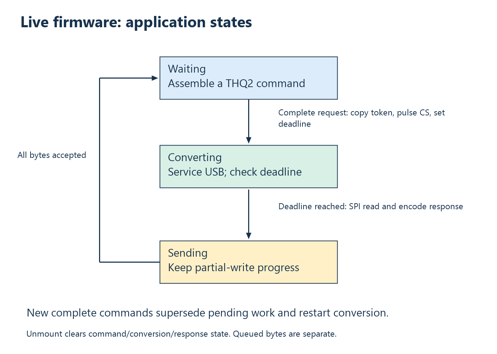

# 10. The live firmware as a state machine

## Read the loop as a set of states

The full [live firmware](../../firmware/thermometer_usb.c) is small enough to
read in one sitting, but its behavior is easier to understand as state plus
transitions. Variables preserve unfinished work between iterations. The main
states are waiting for a command, converting, and sending a response. USB
disconnection clears application work.



The implementation uses booleans rather than an enum. `converting` says a
deadline is active; `response_ready` says there are response bytes to queue.
Normal transitions clear one before setting the other. `request_bytes` and
`sent` are progress counters, not additional measurements.

## Initialization and failure

The program first initializes the sensor interface. Then it supplies a
`tusb_rhport_init_t` structure selecting device role and full speed to
`tusb_init`. If initialization fails, `panic` stops normal execution. There is
no retry loop or diagnostic channel over CDC in this target.

The buffers are fixed-size arrays. A 20-byte request buffer receives commands;
a 32-byte packet buffer holds a response; a 16-byte token buffer preserves the
current request identifier. These are allocated in `main` and remain alive for
the loop's entire execution.

`conversion_done = nil_time` provides an initial value, but the program uses
that deadline only while `converting` is true. A validity flag plus storage is
a common embedded representation: not every bit pattern in storage is
meaningful at every moment.

## Service USB before application work

```c
while (true) {
    tud_task_ext(0, false);

    if (!tud_vendor_mounted()) {
        request_bytes = 0;
        converting = false;
        response_ready = false;
```

The task call processes pending USB events without waiting for a new event.
TinyUSB defers substantial processing from hardware interrupt handling to task
context. Repeatedly running the task keeps control requests, receive events,
and transfer completion processing moving. See the stack's
[architecture documentation](https://docs.tinyusb.org/en/latest/reference/architecture.html).

If the vendor interface is not mounted, a partial command and pending result
are abandoned. The code does not preserve application work across unplugging.
TinyUSB manages its own endpoint state; resetting these variables resets the
application's interpretation of that work.

The loop ends with `sleep_ms(1)`. This yields a small delay, reducing busy
spinning. It does not establish a guaranteed one-millisecond service period:
USB work, interrupts, and application processing occupy time as well.

## Command assembly accepts fragments

```c
while (tud_vendor_available()) {
    if (tud_vendor_read(request + request_bytes, 1) != 1) {
        break;
    }
    ++request_bytes;
    if (request_bytes >= 4 &&
        memcmp(request, THERMO_REQUEST_MAGIC, 4) != 0) {
        memmove(request, request + 1, --request_bytes);
    }
```

The firmware consumes one byte at a time from the vendor receive buffer.
After at least four bytes exist, it checks the prefix. If wrong, it discards
one byte and shifts the remaining bytes toward the start. `memmove` is used
because source and destination overlap. `memcpy` would not be an appropriate
replacement for that overlapping shift.

Before a prefix is found, the counter hovers around three or four bytes as the
window searches. Once the prefix is correct, bytes accumulate to twenty. The
firmware does not assume one USB read equals one command and does not read
beyond the buffer before resetting the count.

There is no command length field, checksum, authorization, or explicit error
reply. Any twenty-byte candidate starting with `THQ2` supplies a token. The
stream scanner is sufficient for this constrained exchange, not a general
command language for untrusted clients.

## Command completion starts new work

When twenty bytes have accumulated, the program copies the final sixteen
bytes to `token`, clears the assembly counter, pulses CS, and creates the
250 ms deadline. It sets `converting` true and discards any not-yet-queued
response state.

A later complete command supersedes the previous pending command. If a
misbehaving client continuously sends commands faster than conversions finish,
it can continually restart the wait. The current DLL avoids this through
serialized request/wait use and exclusive opening. The firmware itself does
not implement a fair queue for many requests.

Bytes already queued into TinyUSB cannot be “unsent” by changing
`response_ready`. The token is therefore still important: a response produced
for earlier work may remain in transport buffers. Application state reset and
transport-buffer history are not identical.

## Wait without blocking the whole application

```c
if (converting && time_reached(conversion_done)) {
    uint16_t raw = max6675_read_raw();
    encode_temperature_packet(packet, raw,
        to_ms_since_boot(get_absolute_time()), token);
    converting = false;
    response_ready = true;
    sent = 0;
}
```

Successive iterations continue USB processing until the deadline has passed.
Only then does the short SPI transaction occur. The timestamp is captured at
readout, the response is encoded, and send progress begins at zero.

The condition is “time reached,” not “time exactly equal.” Equality would be
fragile because the loop may skip the exact tick. Deadline checks should
continue to work when processing resumes slightly late.

## Partial writes preserve progress

```c
sent += tud_vendor_write(packet + sent, sizeof(packet) - sent);
tud_vendor_write_flush();
if (sent == sizeof(packet)) {
    response_ready = false;
}
```

The next write starts at the first byte not yet accepted by TinyUSB. If only
ten bytes were accepted, the next attempt offers twenty-two, not the entire
response again. If zero were accepted, progress stays unchanged and the loop
tries later. Finite FIFO capacity becomes backpressure rather than silent
duplication.

Accepted bytes have entered TinyUSB's transmission path. That is not a proof
that Windows parsed the response or that the console displayed it. The
application does not add a host acknowledgement after the response. Distinguish
local queue acceptance from end-to-end application completion.

## Check your understanding

1. Why does this loop need both `request_bytes` and `sent`?
2. What happens if a second valid command arrives during conversion?
3. Why is a long `sleep_ms(250)` a different design from this deadline check?
4. What does clearing `response_ready` prove, and what does it not prove?

Answers: [Chapter 10](24-answers.md#chapter-10).

<!-- NAVIGATION -->

---

[Previous: 9. Three firmware applications as controlled experiments](09-three-firmware-walkthroughs.md) · [Contents](README.md) · [Next: 11. The wire protocol, byte by byte](11-wire-protocol-workshop.md)
