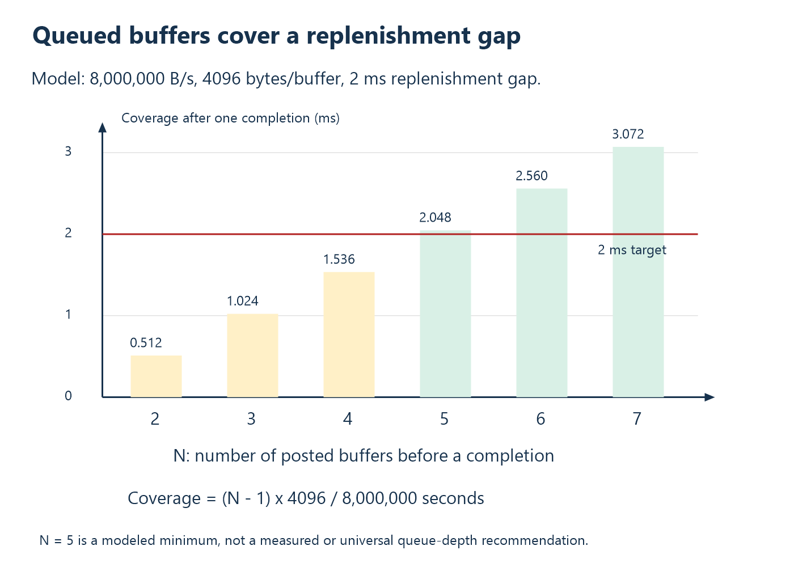

# 11. Continuous streaming and real-time requirements

A fast average does not establish a real-time guarantee. A real-time requirement
states when data or an action is required and what happens when it is late.
Hard deadlines need defensible bounds; a soft real-time display may tolerate
some lateness. Define acquisition rate, acceptable age, latency, and loss policy
before choosing a driver or transfer type.

The examples below examine continuous acquisition rather than a particular
board. They are models, not measurements. Bulk USB on a general-purpose OS does
not acquire hard deadlines through asynchronous calls or a custom kernel driver.

## A stream has its own clock

A request/response design starts acquisition for a command. A stream produces
samples on a device-side schedule independent of each host function call.
The host can start/stop acquisition and configure it, while results arrive in
blocks. This separates the acquisition clock from desktop scheduling.

Consider an audio-like acquisition device producing 48,000 samples/s per
channel. If Windows briefly takes longer to handle a completion, the sample
clock should not slow down to follow the UI thread. Device buffers absorb the
gap, and the host catches up within a defined capacity budget. If the gap
exceeds capacity, the protocol reports loss or stops according to policy.

“Continuous” therefore describes production and transport organization, not a
guarantee of infinite storage or zero latency. A stream is a queueing system
with finite resources and clocks.

## Choose transfer semantics from the loss/latency contract

Bulk preserves reliable delivery through its transport mechanisms but has no
reserved bus-time guarantee. It can suit a measurement recorder that tolerates
variable delivery delay within available buffering. Isochronous reserves
periodic service opportunities and does not retry damaged/missing data in the
same way. It can suit audio where old data is often less useful than a timely
next interval. Interrupt transfers also receive periodic service but are not
interchangeable with bulk or isochronous simply because a device is “real-time.”

Microsoft's [isochronous endpoint overview](https://learn.microsoft.com/en-us/windows-hardware/drivers/usbcon/transfer-data-to-isochronous-endpoints)
explains service intervals and payload limits. The
[bandwidth-allocation guidance](https://learn.microsoft.com/en-us/windows-hardware/drivers/usbcon/usb-bandwidth-allocation)
explains competition and topology. A reserved USB service opportunity does not
guarantee that a Windows application processes the result by a hard deadline.

Choose explicitly: Is a missing sample acceptable if reported? Is variable
delay acceptable? Must every sample reach storage? How long can the device
wait before discarding data? Those answers determine transport and buffer
policy more directly than the label “fast.”

## Host support and device support must agree

WinUSB includes isochronous APIs on supported Windows versions; libusb also
provides asynchronous isochronous facilities. A selected API cannot change a
bulk device into an isochronous one. Descriptors, stack/class support, endpoint
configuration, production timing, and host submission must describe the same
design. See the [WinUSB isochronous guide](https://learn.microsoft.com/en-us/windows-hardware/drivers/usbcon/getting-set-up-to-use-windows-devices-usb)
and [libusb asynchronous reference](https://libusb.sourceforge.io/api-1.0/group__libusb__asyncio.html).

## Worked example: stereo packed 24-bit audio

Assume two channels, 48,000 samples/s/channel, and three stored bytes/sample:

```text
R = 2 * 48,000 * 3 = 288,000 bytes/s
Data produced in 1 ms = 288 bytes
```

A full-speed isochronous endpoint can carry up to 1023 bytes per 1 ms service
frame, subject to descriptor allocation and bus scheduling. The 288-byte
demand fits that per-interval payload ceiling. This is a capacity feasibility
check, not proof of a compliant USB Audio implementation or a successful
TinyUSB configuration. Headers, clocks, feedback, and class behavior depend
on the chosen protocol.

If samples are packed in four bytes instead, demand becomes 384 bytes/ms.
Still feasible against 1023, but requiring one-third more payload capacity.
Representation choices matter even when physical converter resolution is
unchanged.

Now try eight channels at 96,000 samples/s with four-byte storage:
`8 * 96,000 * 4 = 3,072,000 B/s`, or 3072 bytes/ms. That exceeds one full-speed
isochronous endpoint's 1023-byte/ms ceiling. You need a different architectural
choice, not a larger host output array.

For comparison, a high-speed endpoint configured for 1024 bytes every
125 microseconds has a payload budget of `1024 * 8000 = 8,192,000 B/s`.
Some high-bandwidth high-speed endpoints support additional transactions per
microframe; do not assume those capabilities for an arbitrary device. The
RP2040's native full-speed controller does not acquire high-speed capability
through this calculation.

## Clock mismatch slowly destroys an apparently adequate queue

Suppose a producer nominally runs at 48,000 sample frames/s, but its clock is
100 parts per million faster than a consumer's independent clock. The
difference is:

```text
Delta F = 48,000 * 100 / 1,000,000 = 4.8 sample frames/s
```

For stereo packed 24-bit frames, each frame contains six bytes. Drift is
`4.8 * 6 = 28.8 bytes/s`. An initially empty 10 ms audio buffer stores
`288,000 * 0.010 = 2880 bytes`. At this constant difference, it fills in
`2880 / 28.8 = 100 seconds` even though average rates look equal when rounded.
Starting half full gives only half that one-direction headroom.

This is a hypothetical clock model, not a measured oscillator tolerance.
Professional streaming designs need clock relationship and feedback, adaptation,
or resampling policies where appropriate. Bigger buffers postpone drift-induced
overflow; they do not synchronize independent clocks.

## Keep requests queued so the transport has work

A synchronous loop can leave a gap between receiving one block and submitting
the next read. Multiple asynchronous transfers let the controller continue
with queued work while the host processes completed buffers. This hides some
software latency and improves sustained operation.

Assume a high-speed-capable acquisition device and a suitable host path,
separate from the full-speed RP2040. Consider its hypothetical 8,000,000 B/s
receive stream with 4096-byte transfer buffers. One buffer represents
`4096 / 8,000,000 = 0.512 ms` of data. After one
transfer completes, suppose the host can take up to 2 ms to replenish it under
the stated design model. With N buffers, remaining posted capacity is
approximately `(N - 1) * 4096` bytes. Require:

```text
(N - 1) * 4096 / 8,000,000 >= 0.002
N >= 1 + ceil(16,000 / 4096) = 5
```



Five is a minimum for this simplified coverage model, not a universal optimal
queue depth. Real completion batching, device-side storage, short packets,
controller behavior, processing time, and bursts affect the choice. Queue
depth cannot fix a consumer that is permanently slower than the stream.

## Buffer ownership is a state machine

Use explicit states such as FREE, SUBMITTED, COMPLETED, PROCESSING, and RETIRED.
A submitted buffer belongs to outstanding I/O and must remain allocated and
unmodified according to the API contract. A completed buffer can be parsed or
handed to a worker. A processing buffer cannot also be overwritten by a newly
submitted transfer unless an intentionally synchronized design permits it.

The following **pseudocode** is architectural, not a replacement implementation:

```text
START: allocate buffers; submit initial receive requests
COMPLETION: record actual count/status; place completed data in processing queue
WORKER: validate frames; update sequence/age; publish or store results
REUSE: return an eligible buffer to the receive queue
STOP: stop producing work; cancel outstanding requests; drain completions
FINAL: free buffers only after nothing can still complete into them
```

Cancellation requested is not the same state as cancellation completed. The
asynchronous API's completion rules determine when memory can be reused or
freed. Avoid doing expensive rendering, file work, or blocking computation in
the I/O completion path; it must keep the transport supplied with eligible
buffers.

## Stream frames need more than a request token

A useful stream header can include protocol version, block length, first sample
sequence, number of scans, timestamp definition, and overflow indicators.
Sequence gaps expose missing data. A timestamp links data to an acquisition
clock. An overflow flag explains that the device lost data before transmission.
None of those can be recovered merely by observing a successful host read.

You might retain request IDs for start/stop/configuration commands while using
sequence numbers for streaming blocks. They answer different questions:
“Which command did this acknowledgement satisfy?” versus “Where does this
block belong in the acquisition sequence?” The thermometer's per-request token
should not simply be repeated on every stream frame and called complete
sequencing.

## Backpressure must have an application meaning

If the host stops accepting data, choose whether acquisition pauses, drops the
oldest block, drops the newest block, or stops with an explicit fault. For a
continuous externally clocked sensor, “pause acquisition” may not be physically
possible. For a control display, preserving the newest state may be more useful
than replaying stale history. For a recorder, silent loss may be unacceptable.

Document reconnect behavior too. Does a new session begin a new epoch? Do
sequence numbers reset? Can a host distinguish a device restart from a wrap?
Does stop acknowledge that sampling ended, that queued bytes drained, or both?
These definitions matter more than the particular choice of C struct names.

## Professional acceptance criteria

Qualify sustained rate, bounded memory use, observed latency distribution,
sequence integrity, overflow reporting, stop/cancel cleanup, and reconnect
semantics under a specified workload. Include deliberate consumer stalls,
device removal, and invalid/short transfer results. Distinguish observed maxima
from proven deadlines.

A complete stream design defines its clock, queue, loss, and lifetime contracts
in addition to its byte layout. Capacity alone is not a sufficient contract.

## Review problems

1. Recalculate stereo 48 kHz demand using four bytes/sample.
2. Why does “fits in an isochronous interval” not prove end-to-end real-time
   application behavior?
3. In the five-buffer example, what coverage remains immediately after one
   completion? Why is N, rather than N minus one, optimistic at that instant?
4. What happens to the 10 ms buffer drift example if the rate difference is
   50 ppm rather than 100 ppm?
5. Define stop semantics for a recorder that must preserve every already
   acquired sample before closing.

Worked answers: [Appendix A](appendix-a-exercises.md#chapter-11).

<!-- NAVIGATION -->

---

[Previous: 10. Capacity, latency, and bottleneck calculations](10-capacity-and-bottlenecks.md) · [Contents](README.md) · [Next: 12. Case study, experiments, and further driver work](12-thermohost-case-study.md)
