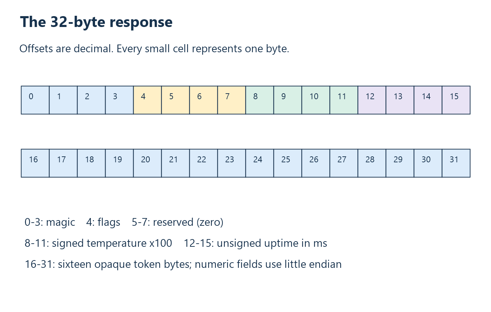

# 11. The wire protocol, byte by byte

## A protocol is an agreement, not a C structure

The shared [wire header](../../protocol/thermo_wire.h) defines request size 20,
response size 32, token size 16, capability request `0x22`, and the two magic
strings. The encoder and decoder use explicit offsets. They never transmit a
native object containing compiler-dependent padding or pointer values.

This separation allows an Arm C program and an x64 C++ DLL to agree. A `double`
is convenient inside Windows; it need not be the wire representation. An
opaque pointer is convenient inside the host process; it cannot identify an
object across USB.

## Requests are simple

| Offset | Length | Content |
| --- | --- | --- |
| 0 | 4 | ASCII `THQ2`: bytes `54 48 51 32`. |
| 4 | 16 | Opaque token generated for this read. |

The token has no numeric byte order because the application treats it as an
opaque byte sequence. Firmware copies it unchanged. In explanations we often
use token `00 01 ... 0F` because it is readable; the real DLL uses cryptographic
system random bytes, not that teaching pattern.

For that example token, the complete command is:

```text
54 48 51 32 00 01 02 03 04 05 06 07 08 09 0A 0B 0C 0D 0E 0F
```

There is no command ID beyond the magic/version prefix because this version
has only one command. Future commands would require an explicitly designed
extension rather than reinterpretation of existing token bytes.

## Responses carry meaning and correlation



| Offset | Length | Meaning |
| --- | --- | --- |
| 0 | 4 | ASCII `THR2`: `54 48 52 32`. |
| 4 | 1 | Flags: bit 0 indicates open thermocouple; other bits must be zero. |
| 5 | 3 | Reserved bytes, all zero. |
| 8 | 4 | Signed temperature x100, little endian. |
| 12 | 4 | Unsigned device uptime in milliseconds, little endian. |
| 16 | 16 | Echo of the request token. |

Reserved bytes are not arbitrary padding. They are defined transmitted bytes.
The parser rejects nonzero values so future meanings cannot silently be
misinterpreted by an older DLL. The protocol deliberately gives invalid flags
precedence over a sensor-fault interpretation.

## Build a valid example by hand

Choose temperature 25.50 C, uptime 1000 ms, and token `00` through `0F`.
Temperature x100 is 2550, hexadecimal `000009F6`. Uptime is `000003E8`.
The complete response is:

```text
54 48 52 32 00 00 00 00 F6 09 00 00 E8 03 00 00
00 01 02 03 04 05 06 07 08 09 0A 0B 0C 0D 0E 0F
```

Count the bytes. There are sixteen on each displayed line. These line breaks
exist only for human reading and are not transmitted. Offsets 8 and 12 refer
to positions in the combined array, not positions in the second line.

For a fault at the same uptime, set byte 4 to `01` and bytes 8 through 11 to
zero. The DLL returns SensorFault and leaves the caller's previous output
unchanged. Zero is a placeholder in an invalid field, not a reported 0 C.

For the parser's synthetic -10.25 C test, temperature bytes are `FF FB FF FF`.
This tests signed decoding; the MAX6675 source in this repository constructs
only nonnegative count-based values.

## The encoder's deliberate ordering

```c
memset(packet, 0, TEMPERATURE_PACKET_SIZE);
memcpy(packet, THERMO_RESPONSE_MAGIC, 4);
packet[4] = valid ? 0x00 : 0x01;
memcpy(packet + 16, token, THERMO_TOKEN_SIZE);
```

Zero-initializing all thirty-two bytes establishes reserved values and avoids
leaking uninitialized stack contents. Then the encoder fills the prefix,
flags, token, and four-byte fields. Each `memcpy` uses the exact intended
length; the magic's C zero terminator is excluded.

The temperature and timestamp loop writes low-order bytes first by shifting
eight more bits per iteration. Although the temperature variable is unsigned
in this firmware, its emitted nonnegative values are valid signed protocol
values. That implementation choice does not erase the protocol's signed
definition.

## Why random tokens help freshness

Suppose request A times out but its response is buffered somewhere. Request B
arrives later. Without correlation, the next received temperature might be A's
result and be mislabeled B's fresh measurement. With different tokens, the
parser skips A's response and continues waiting for B's.

The firmware must still perform a new conversion. Echoing B's token on a cached
old sample would satisfy correlation while violating the measurement policy.
Freshness depends on **both** device-side sequencing and host-side matching.

Random 128-bit tokens make accidental cross-request matches extremely
unlikely. They do not authenticate a hostile device or client. A party that
can read the current request can copy its token. This booklet uses the token
as correlation data, not as a security mechanism.

## Version negotiation and migration

The capability reply is `54 48 02 14 20`. Its first two bytes are `TH`, followed
by wire version, request size, and response size. The DLL compares all five
bytes exactly. A device with the same endpoints but the older ten-byte stream
is rejected during open rather than decoded under the new rules.

API version 3 identifies the application-facing DLL behavior. Wire version 2
identifies the transport contract. They evolve independently. A future DLL
could support several wire versions, but this implementation supports exactly
the expected capability tuple.

## Check your understanding

1. Encode 42.25 C at uptime 2000 ms using token `00` through `0F`.
2. Why do all-zero temperature bytes not always mean a valid 0 C?
3. Which two independent mechanisms establish fresh-read behavior?
4. What must change if a future version assigns a meaning to reserved byte 5?

Answers: [Chapter 11](24-answers.md#chapter-11).

<!-- NAVIGATION -->

---

[Previous: 10. The live firmware as a state machine](10-live-firmware-state-machine.md) · [Contents](README.md) · [Next: 12. Control requests and the Microsoft descriptors](12-control-and-os-descriptors.md)
