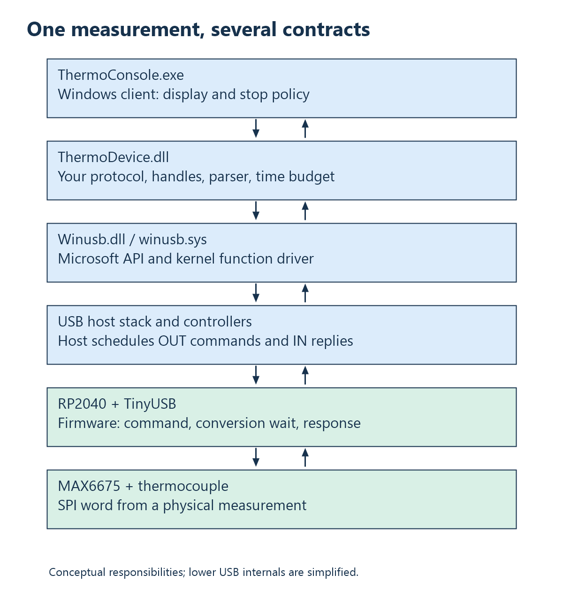
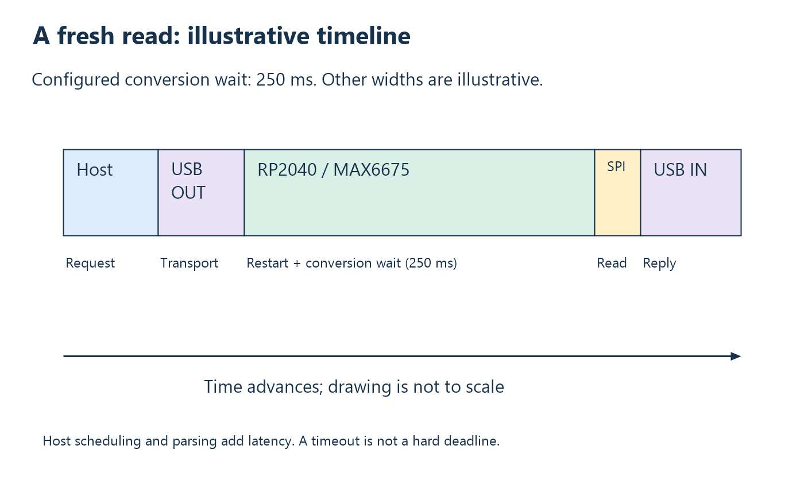

# 12. Case study, experiments, and further driver work

The preceding chapters developed representation, transport, drivers, firmware
stacks, acquisition, protocols, ownership, and timing. This chapter brings
them together in one small instrument. Its purpose is to test those concepts
against inspectable source rather than make the repository itself the subject
of every lesson.

## One instrument, two processors

ThermoHost connects a MAX6675 thermocouple converter to an RP2040-Zero, then
to a Windows application. The board runs Arm firmware built with the Pico SDK.
Windows runs an x64 console and DLL built with MSVC. Their executable formats,
address spaces, and toolchains differ; the shared agreement is a byte protocol.



The sensor is wired SO to GP0, CS to GP1, and SCK to GP2, with the existing
3V3/GND connections. Change wiring with USB disconnected. The board's
BOOT-mode programming drive is separate from its runtime USB personality.

## Three firmware programs isolate three questions

| Target | Question isolated | Output |
| --- | --- | --- |
| `firmware` | Does real sensor acquisition work? | Approximately 250 ms polling, CDC text, and a ten-byte frame printed as hex. |
| `usb_probe` | Does the vendor USB path work with known data? | Synthetic 42.25 C ten-byte frames every 250 ms, with uptime. |
| `thermometer_usb` | Can host requests obtain fresh real conversions? | One token-matched 32-byte response for requested acquisition. |

Flash one application at a time. `.uf2`, `.elf`, and `.bin` for one target are
different build formats, not three programs to install together. The current
DLL requires `thermometer_usb.uf2`; it rejects the probe's older protocol at
capability checking. Historical probe tests need matching historical host code.

The live target adds `THERMO_FRESH_READS=1` when compiling the shared descriptor
source. That enables its capability reply. The vendor targets disable SDK USB
stdio and use custom TinyUSB descriptors. The terminal target instead enables
CDC. These are deliberate configurations, not contradictory descriptions of
one running image.

## Trace one successful reading

The console explicitly loads the DLL and resolves its exports. API version 3
is required. The DLL discovers the matching Windows interface, opens
exclusively, initializes WinUSB, finds bulk pipes, and verifies capability
`TH`, wire version 2, lengths 20/32.

A read generates a random sixteen-byte token and sends `THQ2` plus that token.
The firmware assembles the command, restarts the sensor conversion, and records
a deadline 250 ms ahead. It keeps servicing TinyUSB while waiting, reads SPI,
encodes flags/temperature/uptime/token, and queues the response with partial-write
progress retained.



The DLL's parser skips noise and old tokens, validates reserved fields and
fault flags, converts signed temperature x100 to `double`, and publishes only
on success. A sensor fault leaves caller temperature unchanged. The API does
not expose the timestamp. The host's command/response waiting policy uses one
1000 ms budget; open is separate and neither is a proven hard deadline.

The console prints temperature only for Ok. SensorFault permits another
attempt; other read failures end the session. Ctrl+C sets an atomic stop flag;
main closes after any active synchronous read, then unloads the DLL.

## Reproduce the baseline

Open the configured Pico SDK terminal in `firmware` and build:

```powershell
cmake --build build --target thermometer_usb
```

Use BOOT mode to copy `firmware/build/thermometer_usb.uf2` to the RPI-RP2 drive.
Open [ThermoHost.sln](../../ThermoHost/ThermoHost.sln), select Debug/x64,
and build the Windows solution. Keep the new DLL beside the console in
`ThermoHost/x64/Debug`. From that directory:

```powershell
.\ThermoConsole.exe --samples 3
.\ThermoConsole.exe --samples 3 --interval-ms 3000
```

The sample option limits attempts, including fault results. The interval adds
a pause after each nonfinal attempt; it is not a fixed sample period. Three
reads with 20-second pauses take about `3 * 0.25 + 2 * 20 = 40.75` seconds plus
overhead. Displayed read duration excludes those pauses.

## Test claims at their own boundaries

A host-only parser test proves behavior for supplied byte sequences, not
fresh physical conversion. A logic-analyzer capture proves observable SPI
behavior, not DLL cleanup. A connected-device run establishes an observed
integration result under its tested conditions. Name the boundary whenever
recording evidence.

| Experiment | Claim tested | Limit |
| --- | --- | --- |
| Parser with old token and fragments | Correct identity/framing behavior. | No sensor or USB hardware involved. |
| Three finite live reads | Baseline acquisition/transport/cleanup. | Does not establish every fault path. |
| Long idle pauses and temperature change | No replay of an idle sample backlog. | Does not prove exact displayed age. |
| Current compatible firmware withholding replies | Timeout path after open. | Different from unplugging. |
| Ctrl+C, then reopen | Stop/cleanup for the tested timing. | Not a hard real-time cancellation bound. |

Run the existing host parser suite from the repository root:

```powershell
.\tests\run_fresh_response_tests.cmd
```

It uses a VS2019 Professional environment path. It tests the parser used by
the real read path, including stale tokens, fragments, signed decoding, faults,
and invalid flags. Additional experimental firmware should be clearly labeled
and restored after tests rather than silently changing the baseline.

## Diagnose the first failed stage

| Symptom | First investigation |
| --- | --- |
| DLL cannot load | Binary architecture, runtime module path, built output. |
| No matching interface | Attach, enumeration, binding, advertised GUID. |
| UnsupportedDevice at open | Interface/endpoints/capability and flashed target. |
| DeviceBusy | Another exclusive client/open session. |
| Timeout during read | Command, firmware progress, response, matching token. |
| SensorFault response | Sensor-side condition; important USB operations succeeded. |
| Plausible but wrong value | Raw word, units, scaling, physical setup, calibration. |

Do not treat every symptom as a reason to replace drivers. A current decoded
sensor fault is evidence that a substantial communication path worked.

## Separate recorded evidence from intended behavior

[fresh_reads.md](../fresh_reads.md) records successful finite API-version-3
runs after 3-second and 20-second pauses, including a temperature change and
cleanup. It marks current-version fault/recovery and Ctrl+C hardware checks
as unconfirmed. This book adds explanations, not new board measurements.

For timing work, record the build/commit, flashed image, topology, workload,
sample count, and exact measured interval. An observed maximum is not a proven
worst-case bound. For overload work, report sequence gaps and buffer policy,
not only average throughput.

## The next step toward custom drivers

The transferable skills are request lifetime, resource ownership, interface
discovery, protocol validation, concurrency, and removal behavior. A future
Windows WDF or Linux kernel driver normally still uses the OS USB stack; it
does not become a host-controller driver merely to read this instrument.
Start with the [Windows USB driver overview](https://learn.microsoft.com/en-us/windows-hardware/drivers/usbcon/usb-driver-development-guide)
or [Linux host API](https://www.kernel.org/doc/html/latest/driver-api/usb/usb.html),
then study the selected framework's execution-context and lifecycle rules.

Retain a known-good user-space implementation as a reference. First define
the new requirement—system integration, device management, or a specific
learning objective—then change the layer responsible for it. Sensor timing,
stream capacity, and application semantics remain engineering questions even
after a custom driver exists.

**Exercises.** Design one test each for parser correctness, fresh conversion,
and resource cleanup. State what each test cannot establish. See
[Appendix A](appendix-a-exercises.md#chapter-12).

<!-- NAVIGATION -->

---

[Previous: 11. Continuous streaming and real-time requirements](11-streaming-and-real-time.md) · [Contents](README.md) · [Next: Appendix A. Exercises and worked answers](appendix-a-exercises.md)
