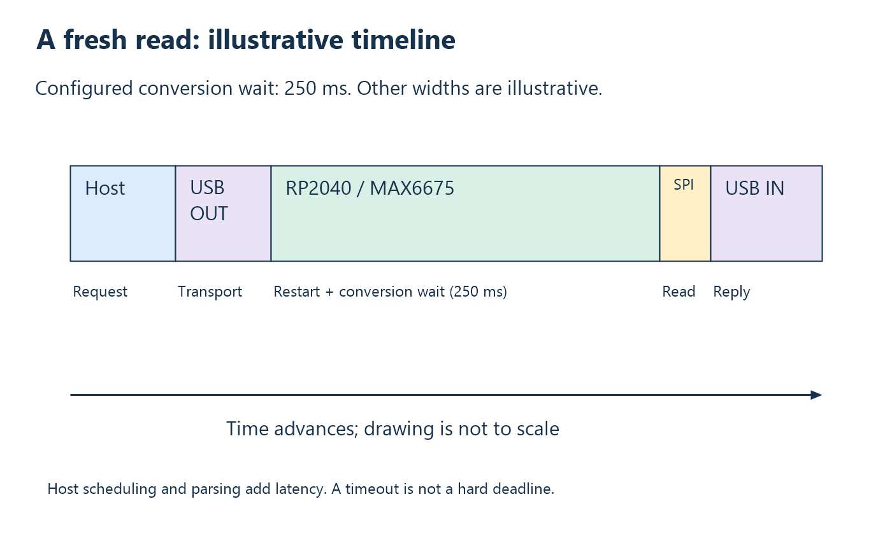
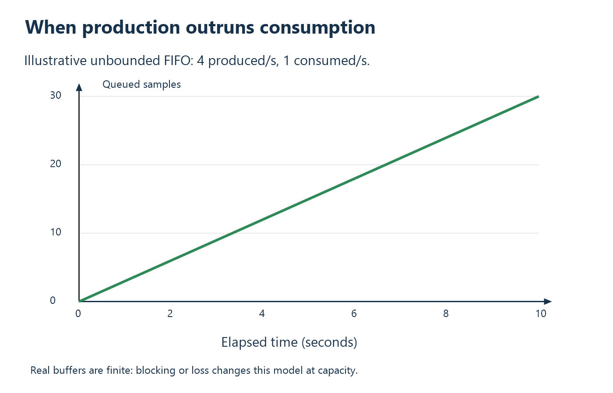

# 19. Real-time thinking: latency, jitter, freshness, and queues

## “Fast” and “real-time” answer different questions

A fast system completes work quickly on average. A real-time requirement says
when a result must be available and what happens if it is late. Hard deadlines
require defensible bounds. A useful soft real-time display may tolerate
occasional late results. ThermoHost is a low-rate request/response thermometer
on general-purpose Windows with bulk USB; it is not a hard real-time system.

Moving code into a kernel driver would not remove sensor conversion time,
reserve bulk bus latency, or eliminate every scheduling and hardware delay.
First state the required measurement rate, maximum age, acceptable loss,
deadline, and failure response. Then choose architecture and validate it.

## Decompose one call's latency

The host-observed read duration includes request creation and submission,
transport to the board, firmware command processing, conversion waiting,
SPI readout, response transport, parser calls, and host scheduling. The
application timestamps only around the exported read call, so it does not
separately measure those terms.

This figure is a model with labeled stages. Its durations beyond the configured
250 ms conversion allowance are illustrative, not measured USB performance.
It deliberately prevents the misleading impression that a 32-byte payload
requires 250 ms to travel through USB.

The short SPI read is not the bottleneck. The conversion dominates expected
normal latency, and scheduling/transport affect variation. A hypothetical
perfectly instantaneous USB link would still leave the conversion wait.

## Freshness is a causal property

This project's successful current response comes from a conversion restarted
after receipt of its command and carries that command's token. This is useful
freshness. It does not promise a result younger than a fixed external deadline
when displayed, because the response can be delayed after acquisition.

A user interested in maximum data age needs more than a token. They need a
timestamp definition, host/device clock relationship or conservative elapsed
time bound, and an acceptance policy. The response contains device uptime,
but the current API exposes only temperature, and there is no clock
synchronization protocol.

## Why streaming can create old data

Suppose a device produces four samples per second while a host consumes one.
An idealized unbounded FIFO grows by three samples per second. After ten
seconds, thirty samples are waiting. If the host keeps reading the oldest,
it falls farther behind even though every USB transfer succeeds.

Real buffers are finite. They eventually block production, drop data, or apply
another policy. The graph is a model of demand mismatch before such a limit,
not a prediction of TinyUSB's exact buffering. The earlier streaming exercise
encountered older queued samples; the present design avoids idle production
instead of trying to drain arbitrary history before each read.

## Choose a queue policy deliberately

| Policy | Benefit | Cost |
| --- | --- | --- |
| Preserve every sample in order | Suitable for complete logs within capacity. | Can accumulate latency; must handle overload. |
| Keep only latest sample | Low age for displays. | Loses intermediate history and requires sequence/age semantics. |
| Bounded queue with reported drops | Predictable memory use and visible loss. | Requires explicit overflow handling. |
| One conversion per request | Simple freshness and no idle backlog. | Adds conversion latency to every call; host paces acquisition. |

There is no universally correct choice. A waveform recorder may need every
sample. A temperature indicator may prefer the latest available state. A
control loop needs a policy defined by its dynamics and deadline requirements.

## Jitter and sampling rate

Jitter is variation in timing. In the current console, the next request begins
after the previous operation, printing, and optional pause. The sample schedule
therefore depends on host execution. An approximate maximum of four conversions
per second is an inference from the 250 ms allowance, not a guaranteed precise
4 Hz clock.

For future regular acquisition, schedule sampling on the microcontroller using
an appropriate timer and hardware support. Buffer results with sequence
numbers and timestamps, then let Windows transport and display them. If a
safety-critical or tightly timed output must occur, put that action at the
layer capable of meeting its timing requirement rather than waiting for a
desktop UI thread.

## Throughput and responsiveness improvements

A higher-rate host path would normally receive chunks into buffers, parse
multiple frames, and use asynchronous requests or a dedicated worker so a GUI
does not freeze. Buffer lifetime must extend until I/O completion. Cancellation,
disconnect handling, and queue capacity then become first-class design work.

On the board, DMA can move peripheral data with less CPU involvement, and
interrupts can signal timely events. Neither is used for this sensor path.
Adding them should solve a measured bottleneck; it is not automatically an
improvement for sixteen SPI bits every quarter second.

The USB controller still schedules bulk traffic on available bandwidth.
Microsoft explicitly documents the lack of reserved bulk bandwidth in its
[bulk-transfer discussion](https://learn.microsoft.com/en-us/windows-hardware/drivers/usbcon/usb-bulk-and-interrupt-transfer).
An asynchronous API improves overlap; it does not transform bulk into a
deadline-reserved transport.

## Quantify a future requirement

Consider a proposed display requirement: 4 Hz measurements, typical update
under 400 ms, no value displayed after a 1-second communication outage, and
visible fault status. That is concrete enough to design and test. “Make it
real-time” is not.

Now consider a proposed 1 kHz control loop with a 100-microsecond deadline.
The MAX6675 conversion allowance alone makes this project architecture
unsuitable. A different sensor/converter and local timing architecture would
be required before the Windows driver question became the main issue.

## Check your understanding

1. Why does token matching not bound displayed sample age?
2. At four produced and one consumed sample per second, what is idealized
   queue growth after ten seconds?
3. Why does asynchronous I/O not establish a hard deadline?
4. State a measurable requirement for your next application using rate, age,
   deadline, and loss policy.

Answers: [Chapter 19](24-answers.md#chapter-19).

<!-- NAVIGATION -->

---

[Previous: 18. Testing the boundaries and diagnosing failures](18-testing-and-diagnosis.md) · [Contents](README.md) · [Next: 20. From this project toward device-driver development](20-toward-device-drivers.md)
