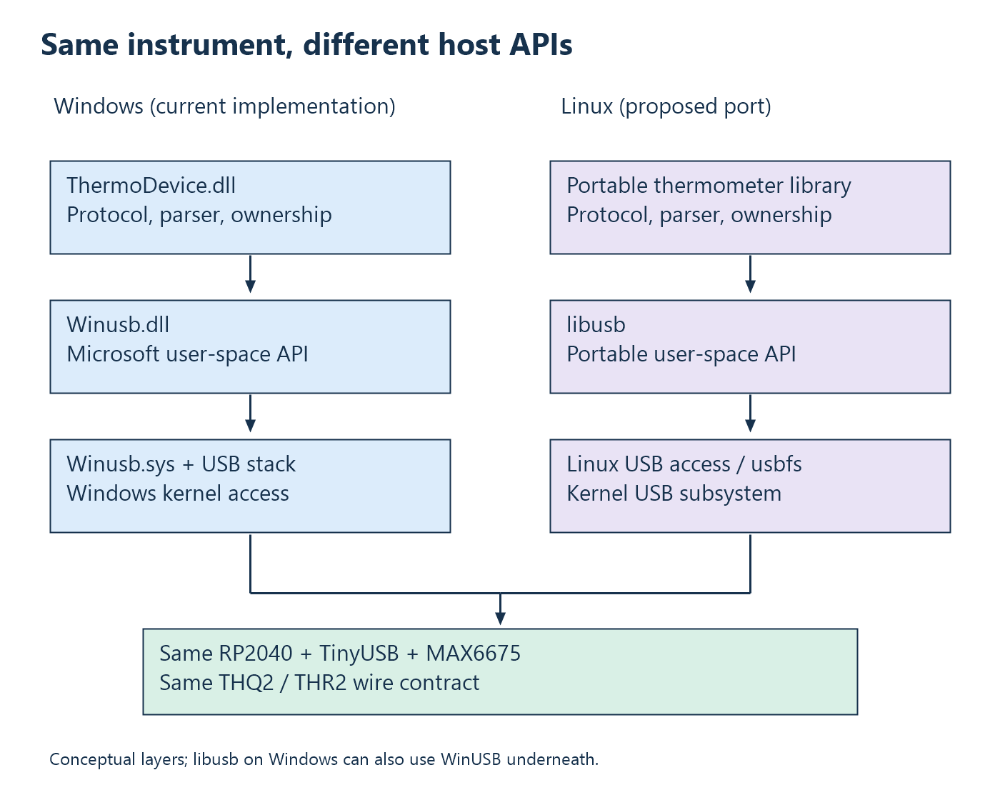

# 25. Linux, libusb, and a portable thermometer library

**Prerequisites:** chapters 7, 11, 13, and 14. **Objective:** explain the Linux
equivalent at the right abstraction level, and design a port that preserves
the thermometer contract without assuming Windows-specific I/O semantics.

## There is an equivalent approach, not an identical component

On Windows, ThermoHost uses a private library above WinUSB. On Linux, a common
user-space approach uses a private library above **libusb**, which accesses
the Linux USB subsystem through its platform backend. The kernel still owns
the host controller and manages the bus. The application does not become a
kernel module just because it sends a control request.

libusb is a cross-platform C library maintained as an open-source project.
It is not the Linux kernel's entire USB stack, not a replacement firmware
stack, and not a Microsoft product. The
[libusb project overview](https://libusb.info/) describes its user-space role;
the [supported-platform notes](https://github.com/libusb/libusb/wiki)
identify Linux usbfs and Windows backends.

The correspondence is consequently asymmetric: WinUSB names a Windows API and
driver arrangement, while libusb names a portable user-space API over different
OS backends. Calling libusb “Linux's winusb.sys” would confuse a library with a
kernel driver. Calling it “a practical Linux user-space alternative to direct
WinUSB calls” is much more accurate.

## Compare the stacks



| Responsibility | Current Windows route | Potential Linux route |
| --- | --- | --- |
| Thermometer API and framing | ThermoDevice code | Reused portable logic plus a Linux backend. |
| Host user-space USB API | WinUSB functions | libusb functions. |
| Discovery | SetupAPI interface GUID/path | libusb enumeration, descriptors, selection policy. |
| Kernel access | WinUSB function driver and Windows USB stack | Linux USB subsystem and user-space access facilities. |
| Device side | RP2040 firmware and TinyUSB | Same RP2040 firmware and TinyUSB. |

The Linux kernel's [host-side USB documentation](https://www.kernel.org/doc/html/latest/driver-api/usb/usb.html)
distinguishes core/controller work, interface drivers, synchronous operations,
and asynchronous URBs. Its APIs are kernel APIs; desktop libusb functions are
a different interface. Both eventually request work from the host controller.

## What can stay the same?

Keep `THQ2`, `THR2`, field offsets, token size, fault interpretation, and
temperature scaling. Keep the rule that only a current valid response updates
caller output. Keep the sensor's restart/wait/read sequence. These are
application and firmware contracts rather than Windows operating-system
objects.

What changes is device discovery, access, random-token generation, time source,
USB calls, and handle cleanup. The public export attributes and `__cdecl`
declarations are also Windows-oriented. The protocol parser's current header
includes that API header, so it is not yet an entirely platform-neutral module.
A real port would deliberately separate portable status/decoder definitions
from Windows export declarations.

This is a proposed design, not a Linux implementation already present in the
repository. The booklet leaves application source unchanged.

## A porting algorithm you can trace by hand

The following is **pseudocode**, not a complete program or tested port:

```text
initialize libusb context
enumerate candidate devices and inspect descriptors
choose the intended serial/interface, not merely any familiar VID/PID
open a device handle and claim interface 0
send control request (C0, 22, value 0, index 0, length 5)
require reply [54 48 02 14 20]
generate a fresh 16-byte request token
write [THQ2 + token] to bulk OUT and check actual count
read chunks from bulk IN under a decreasing time budget
feed every received byte into the current-token parser
publish a result only after matching identity and validating content
release interface, close handle, and exit context on all final paths
```

libusb's [enumeration and device-handling API](https://libusb.sourceforge.io/api-1.0/group__libusb__dev.html)
documents the context/device/handle/interface operations. Its
[synchronous-transfer API](https://libusb.sourceforge.io/api-1.0/group__libusb__syncio.html)
documents the control and bulk calls, actual byte counts, and timeout
semantics. Actual implementations must handle each returned error and acquired
resource, not just execute this happy-path list.

## Example: the same capability query on another API

The WinUSB setup structure becomes arguments to `libusb_control_transfer`:
request type `0xC0`, request `0x22`, value/index zero, destination length five,
and an explicitly chosen timeout. The returned byte count must be five before
comparing `54 48 02 14 20`.

Notice what did not change: the firmware callback still sees the same setup
request fields. It does not know whether the host used WinUSB, libusb, or a
custom driver to submit them. Host API names are not transmitted in the
temperature protocol.

Now consider failure. An API error, a short successful reply, and a five-byte
reply advertising another version are different observations. Your public
library may map them to a small set of statuses, but diagnostic logs should
retain the failing stage. Porting provides an opportunity to make that policy
explicit instead of copying every historical status mapping blindly.

## Why not copy the one-byte read literally?

The current Windows reader relies on specific WinUSB partial-read retention
policies. A libusb port should not assume a one-byte buffer obtains an identical
sequence of retained bytes across platforms. Use receive buffers appropriate
for endpoint packets and feed each returned chunk through the byte parser.
The parser already accepts one byte at a time; the transport need not request
one byte at a time.

An example chunk of thirty-two bytes yields thirty-two `Feed` calls, all with
the same current token. A chunk containing old data plus part of a new frame
can also be handled. Preserve parser state between reads and reason about any
trailing bytes after a completed response according to the session design.

The [libusb asynchronous-I/O documentation](https://libusb.sourceforge.io/api-1.0/group__libusb__asyncio.html)
discusses transfer buffers, packet boundaries, overflow, completion, and
ownership. These rules deserve study even if the initial port uses synchronous
calls. A portable abstraction should preserve application semantics, not
pretend every backend's buffering rules are identical.

## Access permissions are distinct from compilation

A successfully linked libusb program may still lack access to a Linux USB
device node. Device-node permissions and local policy govern access. A system
can grant suitable access through a narrow device-specific policy, commonly
managed through udev on distributions that use it. This is not a reason to
run every application permanently as root.

A kernel interface driver may also own the interface. libusb distinguishes
opening a device from claiming an interface and offers kernel-driver handling
where supported. Do not indiscriminately detach a class driver from a keyboard,
disk, or audio device to imitate this vendor experiment. Identify the intended
interface and its owner first. The device-handling API documents platform
support and the claim/detach operations.

For ThermoHost's private vendor interface, the goal is access to that interface,
not replacing the system USB host controller driver. Windows GUID properties
are useful to Windows discovery; a Linux client generally discovers and
selects through other metadata.

## Can libusb also run on Windows?

Yes. The [libusb Windows backend](https://github.com/libusb/libusb/wiki/Windows)
can use WinUSB among its supported arrangements. A Windows application using
libusb may therefore still rely on Microsoft's WinUSB driver underneath.
Choosing a portable API does not automatically replace all OS drivers.

This suggests two possible future architectures. Keep the current Windows
backend and add a Linux backend behind a common interface, or use libusb as a
host API on both systems. The first preserves direct exposure to WinUSB for
learning. The second can reduce duplicated host transport code. Evaluate
backend capabilities, deployment, test coverage, and ownership rather than
assuming portability comes for free.

## Linux kernel drivers and device-side gadget drivers

A custom Linux host driver binds to the appropriate USB interface and uses
kernel USB facilities. That is a separate project from a libusb application.
A Linux USB **gadget** driver instead implements the peripheral side on a
Linux-capable device controller. It does not mean the RP2040 must run Linux;
TinyUSB provides this project's embedded device-side stack.

The conceptual lesson is reusable: always specify host/device role and
user/kernel execution context before saying “driver.” Otherwise a request
for “the Linux equivalent” can accidentally compare unrelated layers.

## Review problems

1. Map `ThermoHandle`, `WINUSB_INTERFACE_HANDLE`, and `HMODULE` to the resources
   a hypothetical Linux library would need. Which have no one-to-one mapping?
2. Why can the firmware capability callback remain unchanged in a Linux port?
3. What is wrong with requesting one-byte libusb reads solely because the
   Windows implementation uses one-byte `ReadPipe` calls?
4. Distinguish permission failure, interface ownership, and protocol mismatch.
5. Would using libusb on Windows eliminate the need for a suitable kernel
   driver binding?

Worked answers: [Chapter 25](24-answers.md#chapter-25).

<!-- NAVIGATION -->

---

[Previous: 24. Worked answers and reasoning checks](24-answers.md) · [Contents](README.md) · [Next: 26. Calculating capacity and finding the bottleneck](26-capacity-and-bottleneck-calculations.md)
